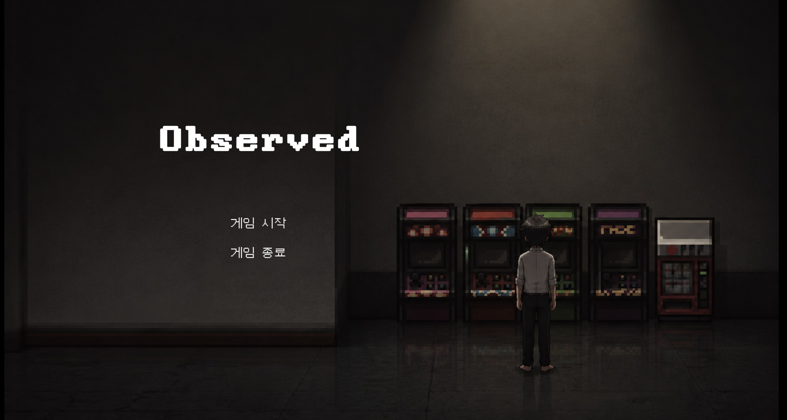
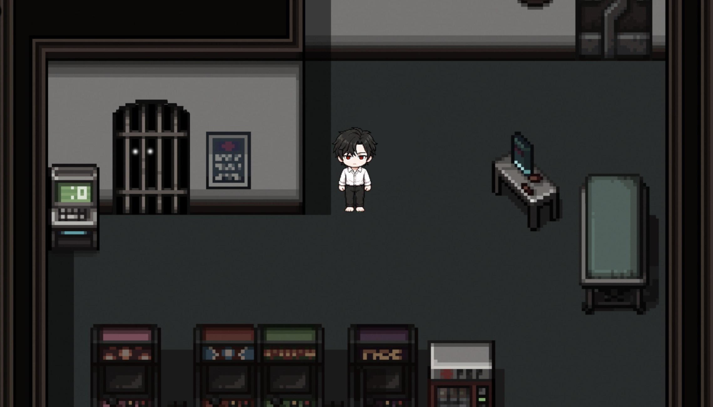
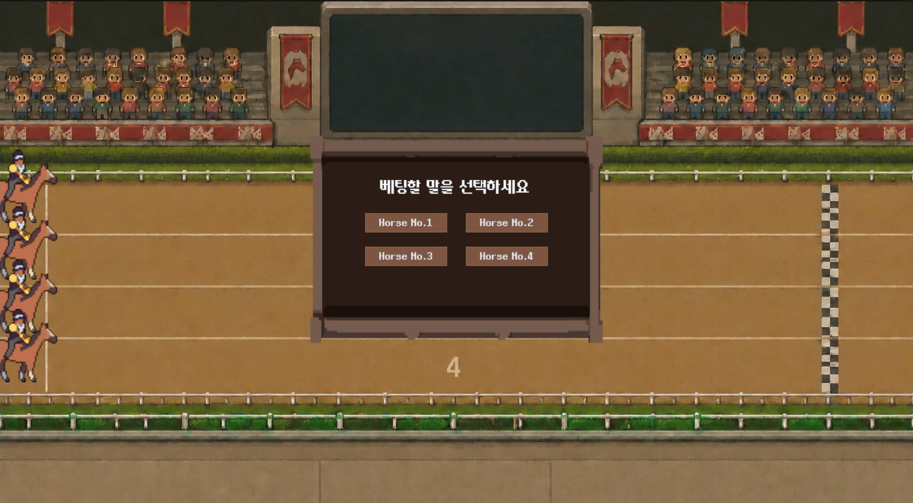
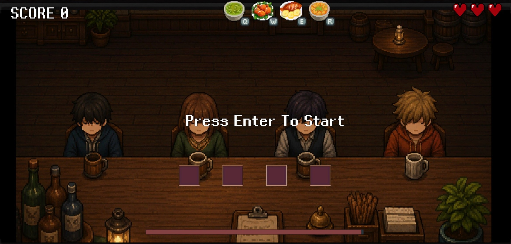
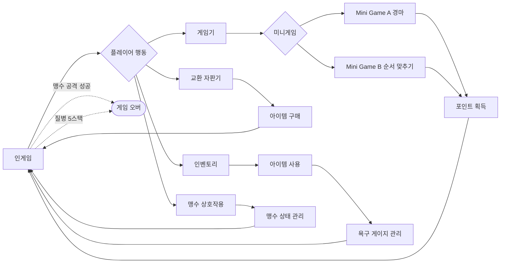
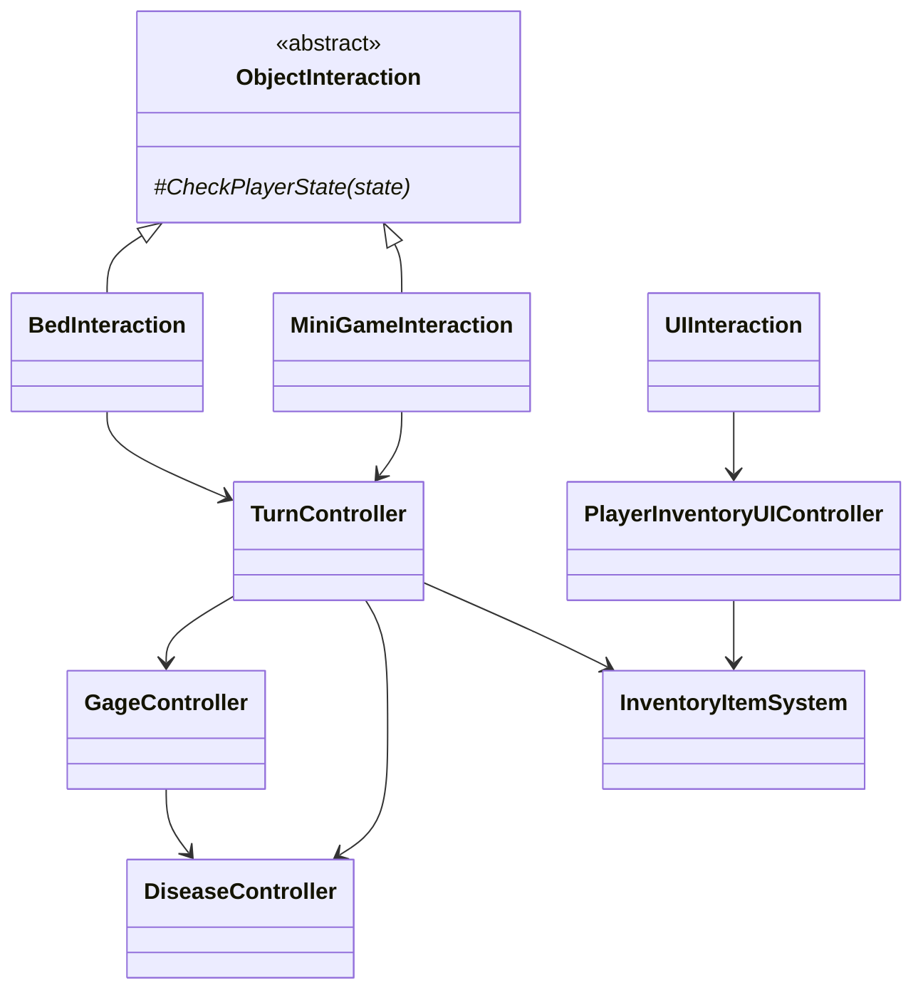
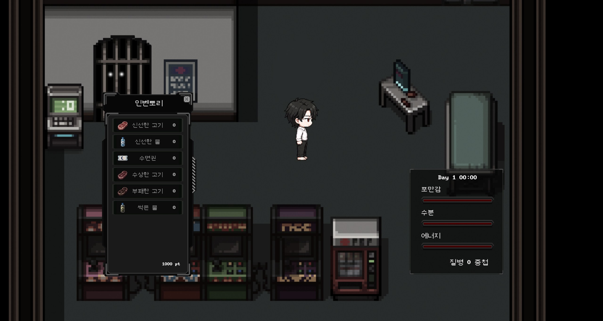
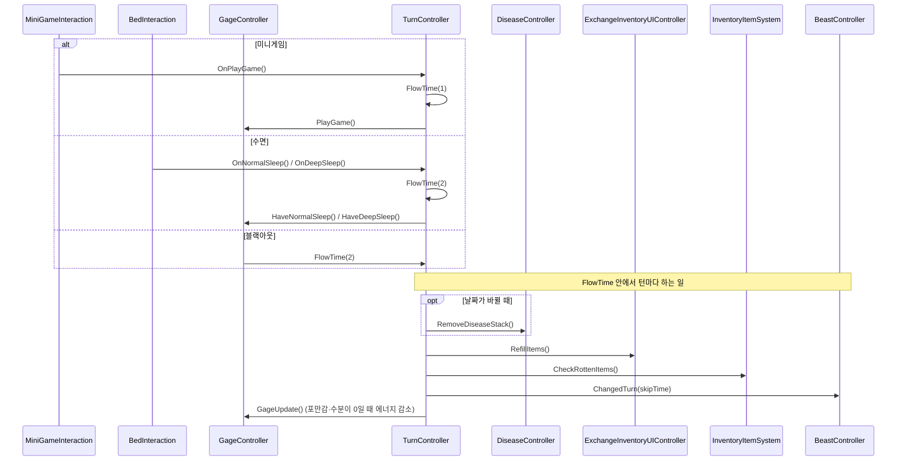
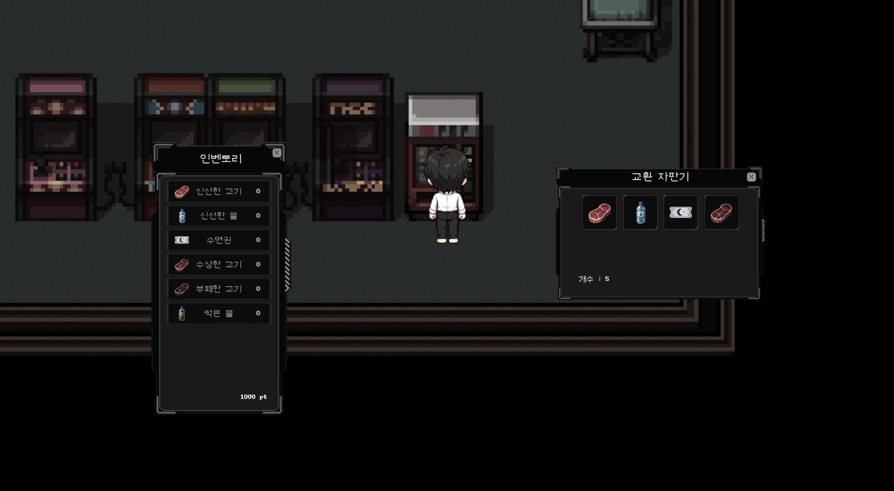
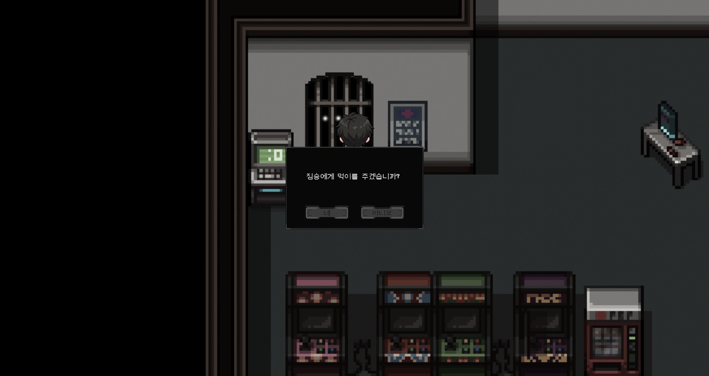

# Observed 기술 문서

> **미니게임으로 자원을 획득해 자신과 맹수를 관리하며 생존하는 탑다운 감금 생존 게임**

| 항목 | 내용 |
|---|---|
| 장르 | 탑다운 2D 감금 생존 (픽셀 아트) |
| 개발 기간 | 2026.06 ~ 2026.07 (개인 프로젝트) |
| 개발 인원 | 1인 |
| 개발 환경 | Unity 6000.3.15f1 (URP 2D) |
| 주요 기술 | 턴 기반 게이지 관리 · 확률 패널티 · 추상 클래스 기반 상호작용 · 코루틴 페이드 연출 · 씬 간 점수 전달 |
| AI 활용 | 캐릭터 이미지 생성 (캐릭터 디자인은 직접) · 타이틀 화면 이미지 생성 (구도는 직접) · 디버그 코드 위치 질문 (4.7) |
| 링크 | [GitHub](https://github.com/BaekShyoun/3rd-2D-Project-BaekShyoun) · [시연 영상](https://youtu.be/vlyz0apxZ-s) |

> 입력 처리 등 일부 유틸리티(`Study.Utilities` — `SimpleInput` 등)는 수업에서 제공받은 코드를 사용했다. 그 밖의 게임 코드는 직접 작성했다.
>
> 캐릭터와 타이틀 화면 등 그래픽 일부는 AI를 활용해 제작했다. 캐릭터 디자인과 타이틀 구도는 직접 정했다(만든 방식과 고친 과정 → 4.7).

---

## 1. 개요

### 1.1 무엇을 만들었나

- 타이틀


고약한 취미를 가진 부자들에 의해 한 방에 갇힌 플레이어가 매일 살아남아야 하는 탑다운 생존 게임이다.
플레이어는 미니게임으로 포인트를 획득하고, 교환 자판기에서 아이템을 구매하여 포만감·수분·에너지와 맹수의 상태를 관리한다.

- 메인 게임


```text
게임 시작 → 미니게임 플레이 → 포인트 획득 → 교환 자판기에서 아이템 구매
         → 포만감 · 수분 · 에너지 · 맹수 상태 관리 → 다시 미니게임 플레이
```

| 구분 | 내용 |
|---|---|
| 목표 | 생존 자원을 관리하며 가능한 오래 살아남기 |
| 게임 오버 | ① 질병 스택이 5 이상 ② 맹수가 탈출할 때 공격 판정(50%)에 걸림 |
| 조작 | WASD 이동 · F 상호작용 · Tab 상태창 · I 인벤토리 · Esc 창 닫기 · 마우스로 UI 선택 |
| 미니게임 | A 경마 · B 순서 맞추기(레스토랑 주문) |

### 1.2 왜 만들었나

자원을 관리하며 **오래 살아남는 것**, 그리고 그 과정에서 **긴장감**을 주는 게임을 목표로 했다.

또한 기괴한 장소에서 발랄한 분위기의 미니게임을 플레이하게 하여, 그 대비로 **기괴함을 연출**하고자 했다.
메인 게임은 어두운 색감과 제한된 공간, 스산한 사운드로 구성하고, 미니게임은 같은 픽셀 아트 스타일이되 밝은 색감과 경쾌한 사운드로 제작하여 괴리감을 주었다.
미니게임은 자원을 획득하는 수단이기도 하다.

**레퍼런스: 심즈(The Sims)**

심즈에서 캐릭터를 일부러 괴롭히며 노는 플레이어들을 보고, 반대로 플레이어 자신이 갇혀 고통받는 상황을 만들자는 생각에서 출발했다.

- 미니게임 A


- 미니게임 B


> 이 문서는 **턴과 게이지 시스템**, **패널티 설계(블랙아웃·상한 고기·썩는 아이템)**, **수면권을 통한 자원 선택**을 중심으로 설명한다.

---

## 2. 시스템 구조

### 2.1 플레이어 행동 흐름



플레이어는 방 안에서 게임기·교환 자판기·인벤토리·맹수 중 하나를 골라 행동하고, 모든 행동은 다시 인게임으로 돌아온다. 맹수 공격과 질병 5스택만 게임 오버로 이어진다.

### 2.2 클래스 관계



침대·게임기 등 상호작용 오브젝트는 모두 `ObjectInteraction`을 상속하며, 턴 경과는 모두 `TurnController`를 거쳐 게이지·질병·아이템에 전파된다.

### 2.3 핵심 클래스 역할 분담

코드의 가독성을 높이고 이후 리팩터링을 용이하게 하기 위해 **기능 단위로 역할을 최대한 분리했다.**
한 가지 규칙(날짜, 욕구, 질병 …)을 변경할 때 하나의 클래스만 확인하면 되도록 하는 것이 목표였다.

| 클래스 | 역할 |
|---|---|
| `TurnController` | 시간·날짜가 바뀌는 것에 관련된 로직. 턴 진행(`FlowTime`), 일반·깊은 수면 |
| `GageController` | 욕구(포만감·수분·에너지) 변화에 관련된 로직. 미니게임·수면에 따른 증감, 블랙아웃 |
| `DiseaseController` | 질병에 관련된 로직. 확률 감염, 수상한 고기 누적, 질병에 따른 감소량 증가, 회복 |
| `InventoryItemSystem` | 포인트와 보유 아이템 관리. 교환 구매(`Buy…`), 사용 시 개수 차감(`DecreaseItem`), 부패 판정(`CheckRottenItems`) |
| `ObjectInteraction` | 사물과 상호작용해 발생하는 이벤트를 묶은 추상 클래스. 침대·게임기·맹수·교환기·이벤트 오브젝트 5개가 상속 (구조 선택 → 4.6) |
| `UIInteraction` | 화면(창) 열기·닫기 전반. 상태창·이벤트 문구·턴 확인·인벤토리·교환창·팝업 |
| `PlayerInventoryUIController` | 인벤토리 창 안의 아이템 상호작용. 아이템 설명, 먹기·버리기·맹수에게 먹이기 팝업과 그 결과 |
| `ScoreManagerGameB` (`ScoreManagerGameA`도 같은 역할) | 미니게임에서 얻은 점수를 씬이 바뀌어도 보관해(`DontDestroyOnLoad`), 메인 게임으로 돌아왔을 때 포인트에 반영할 수 있게 함 |

---

## 3. 턴 진행

### 3.1 행동마다 넘어가는 턴과 게이지 변화

하루는 3시간 단위 8턴(00시 ~ 21시)이다. 모든 게이지는 0 ~ 1(화면에서는 0 ~ 100)이다.

| 행동 | 넘어가는 턴 | 결과 |
|---|---|---|
| `TurnController.OnPlayGame()` (미니게임) | 1 | 포만감 −30 · 수분 −10 · 에너지 −30 |
| `TurnController.OnNormalSleep()` | 2 | 포만감 −50 · 수분 −30 · 에너지 +20 |
| `TurnController.OnDeepSleep()` (수면권 1장 소모) | 2 | 포만감 −50 · 수분 −30 · 에너지 **+40** |
| 블랙아웃 (에너지 0, 자동) | 2 | 포만감 −60 · 수분 −20 · 에너지 회복 없음 |
| 고기 / 물 먹기 | 0 | 포만감 +20 / 수분 +10 |

턴이 넘어갈 때마다 맹수의 탈출 욕구는 턴당 +20씩 증가하며, 포만감·수분이 0이면 각각 턴당 에너지가 10씩 추가로 감소한다. 탈출 욕구가 100에 도달하면 맹수가 탈출한다.

- 상태창


### 3.2 턴 경과를 한 메서드로 처리하기

턴이 넘어갈 때마다 `FlowTime`이 시간·질병·교환 아이템·부패·맹수·게이지를 한 번에 갱신한다.

```csharp
public void FlowTime(int skipTime)
{
    currentHourIndex += skipTime;
    if (currentHourIndex >= hours.Length)
    {
        currentHourIndex -= hours.Length;
        dayCount++;
        diseaseController.RemoveDiseaseStack();
    }
    turnCount += skipTime;
    SetTurnText();

    exchangeInventoryUIController.RefillItems();

    inventoryItemSystem.CheckRottenItems();
    isTimeFlow = true;
    beastController.ChangedTurn(skipTime);
    BecomeZeroValue(gageController.fullnessBar, skipTime);
    BecomeZeroValue(gageController.hidrationBar, skipTime);
}
```

턴 경과는 **반드시 이 메서드 하나로만** 처리되도록 범용적으로 설계했다.
미니게임(`FlowTime(1)`), 수면(`FlowTime(2)`), 블랙아웃(`FlowTime(2)`)은 모두 넘길 턴 수만 인자로 전달하여 같은 메서드를 호출한다.
따라서 턴마다 수행해야 하는 처리(부패, 맹수, 교환기 재고 등)가 추가되더라도 이 메서드 한 곳만 수정하면 된다.



세 행동은 넘길 턴 수만 다를 뿐 모두 같은 `FlowTime`을 거치고, 턴마다 할 일은 `FlowTime` 안에서 한 번에 처리된다.

**예외 상황 방어**

| 방어 | 위치 | 무엇을 막나 |
|---|---|---|
| 게이지를 0 ~ 1 사이로 고정 | `GageController.GageUpdate` | 게이지가 0 아래나 1 위로 나가는 것 |
| 아이템이 없으면 `false` 반환 | `InventoryItemSystem.DecreaseItem` | 없는 고기를 먹거나 없는 수면권을 쓰는 것 (`BedInteraction`은 `false`면 깊은 수면을 하지 않음) |
| `isBlackOut` 플래그 | `GageController.GetBlackOut` | 블랙아웃이 중복으로 실행되는 것 |

---

## 4. 패널티 설계와 구현 방식의 선택

### 4.1 블랙아웃 — 관리 실패에 대한 강제 패널티

미니게임 플레이와 수면은 플레이어가 **게이지 변화를 예상하고 제어할 수 있는** 행동이다.
반면 블랙아웃은 게이지 부족으로 쓰러져 **강제로 턴이 넘어가는** 상황이며, 플레이어가 게이지를 스스로 **제어할 수 없도록** 설계했다.
이는 플레이어 자신의 관리 실패에 따른 패널티이다.

```csharp
public IEnumerator GetBlackOutCoroutine()
{
    yield return StartCoroutine(fadeController.FadeInCoroutine());
    uiInteraction.ActiveEventScriptScreen();
    eventScriptText.text = "휴식을 제대로 취하지 못한 당신은 정신을 잃고 쓰러집니다.";
    GageUpdate(fullnessBar, -gameDecreaseFullness * 2);
    GageUpdate(hidrationBar, -gameDecreaseHidration * 2);
    turnController.FlowTime(2);
    yield return new WaitUntil(()=>(SimpleInput.GetKeyDown(Key.Enter) || SimpleInput.GetKeyDown(Key.Space)));
    yield return StartCoroutine(fadeController.FadeOutCoroutine());

    isBlackOut = false;
}
```

같은 2턴을 소모하는 수면과 달리 에너지가 회복되지 않으며, 포만감·수분은 미니게임의 2배만큼 감소한다.

### 4.2 상한 고기 — 불확실한 패널티

현실에서 상한 고기를 먹는다고 해서 반드시 탈이 나는 것은 아니다. 이 점을 반영하여 **불확실한 패널티**를 부여하고자 했다.
상한 고기·썩은 물을 섭취하면 **30%** 확률로 질병에 걸린다. 플레이어는 위험을 감수하고 섭취할지, 버릴지를 고민하게 된다.

```csharp
public void GotDiseaseByRotten(int percentage)
{
    int number = Random.Range(1, 101);
    if (number <= percentage) AddDiseaseStack(1);
    Debug.Log($"Number : {number}");
}
```

| 질병 규칙 | 값 |
|---|---|
| 상한 고기 · 썩은 물 섭취 | 30% 확률로 +1 |
| 수상한 고기 | 3회 누적 섭취 시 반드시 +1 |
| 게이지가 가득 찬 상태에서 섭취 | 50% 확률로 +1 |
| 하루(8턴)가 지날 때 | 50% 확률로 −1 |
| 질병이 있을 때 게이지 감소량 | `1.2^(질병 수)`배 |
| 게임 오버 | 5 이상 |

### 4.3 썩는 아이템 — 쌓아 두기만 하는 플레이 방지

시간이 지나면 아이템이 썩도록 하여 **쌓아 두기만 하는 플레이를 막고자** 했다. 현실을 반영한다는 의미도 있다.
신선한 고기·수상한 고기는 4턴, 신선한 물은 6턴이 지나면 썩는다.

- 인벤토리·교환 자판기


### 4.4 수면권 — 포인트를 어디에 쓸지 선택권 주기

수면권을 사용하면 더 질 좋은 수면(에너지 +40, 일반 수면은 +20)을 취할 수 있다.
수면권은 교환(200pt)으로만 얻을 수 있으므로, 플레이어에게 **포인트 자원을 수면권에도 쓸지 말지 선택권**을 부여하고자 했다.

### 4.5 기획과 구현의 비교

초기 기획 수치로 직접 플레이해 본 뒤, 아래와 같이 수정했다. 수정한 이유는 크게 세 가지이다.

**① 난이도 — 너무 어렵지도, 너무 쉽지도 않게**

| 항목 | 처음 기획 | 실제 구현 | 바꾼 이유 |
|---|---|---|---|
| 질병 게임 오버 | 3스택 | 5스택 | 3스택일 때는 일주일도 채우지 못하고 게임 오버되어, 플레이 시간을 확보하려고 |
| 하루가 지날 때 질병 | 스택 −2 | 50% 확률로 −1 | 질병이 너무 쉽게 깎여서 오히려 게임이 쉽고 단조로워짐 |

**② 현실감 — 4.2·4.3과 같은 원칙**

| 항목 | 처음 기획 | 실제 구현 | 바꾼 이유 |
|---|---|---|---|
| 게이지 가득 찬 상태에서 섭취 | 반드시 질병 +1 | 50% 확률로 +1 | 배부른데 더 먹는다고 반드시 체하는 것은 아니므로 |
| 고기 부패 | 2턴 | 4턴 | 현실 시간과 비교했을 때 부패가 너무 빨랐음 |
| 물 부패 | 4턴 | 6턴 | 〃 |

**③ 선택지 — 싼 것에는 대가가 따르게**

| 항목 | 처음 기획 | 실제 구현 | 바꾼 이유 |
|---|---|---|---|
| 교환 가격 (신선한 고기·물·수상한 고기·수면권) | 40 · 30 · 30 · 50pt | 200 · 100 · 50 · 200pt | 신선한 고기·물·수면권은 확실히 비싸게, 수상한 고기는 확실히 싸게 해서 패널티를 감안해도 수상한 고기를 사는 데 어느 정도 이득이 있게 함 |
| 맹수 공격 확률 증가 | 플레이어가 수상한 고기를 먹을 때 +5 | 맹수에게 **신선하지 않은** 고기를 줄 때 +5 | 수상한 고기에만 걸면 부패한 고기를 맹수에게 처리하듯 먹일 것 같아서, 신선하지 않으면 무조건 공격 확률이 오르게 함 |

기획서의 수치가 적절한지는 실제로 플레이해 보아야만 알 수 있는 부분이 있다는 점을 배웠다.

### 4.6 구현 방법의 선택

**턴 진행을 어디서 처리할까**

| 방법 | 장점 | 단점 |
|---|---|---|
| **A. `FlowTime` 한 메서드로 모으기 (선택)** | 턴마다 할 일이 늘어도 한 곳만 고침 (→ 3.2) | `FlowTime` 안에서 참조해야 하는 클래스가 많음(질병·교환기·인벤토리·맹수·게이지) |
| B. 행동마다 따로 처리하기 | 각 행동에 필요한 처리만 넣을 수 있음 | 시간이 흘러야 할 때 부르는 메서드가 행동마다 따로 생김. 턴마다 할 일이 늘면 모든 곳을 고쳐야 함 |

→ 처음부터 A로 설계했다(이유 → 3.2).

**상호작용 오브젝트를 어떻게 만들까**

| 방법 | 장점 | 단점 |
|---|---|---|
| **A. `ObjectInteraction` 추상 클래스 상속 (선택)** | 플레이어 감지(`OnTriggerEnter2D`·`OnTriggerExit2D`)와 공통 참조(`CharacterMove`·`UIInteraction`)를 부모 한 곳에 둠. 자식은 상호작용 내용(`CheckPlayerState`)만 구현 | 부모를 바꾸면 자식 5개 모두에 영향 |
| B. 오브젝트마다 각자 구현 | 오브젝트끼리 서로 영향을 주지 않음 | 공통된 역할(플레이어 감지 등)을 오브젝트 5개가 전부 내부에서 따로 구현해야 함 |

→ 침대·게임기·맹수·교환기·이벤트 오브젝트가 공통된 역할을 수행하므로 A를 선택했다.

### 4.7 AI 결과물을 확인하고 고친 과정

| 대상 | 요청 방식 | 의도와 달랐던 점 | 대응 |
|---|---|---|---|
| 캐릭터 이미지 (Nano Banana · ChatGPT) | 움직이는 픽셀아트 캐릭터 에셋을 레퍼런스로 주고, 직접 디자인한 캐릭터를 그 움직임에 입히도록 요청 | 걷는 동작에서 왼발과 오른발을 제대로 구분하지 못함 | 발 구분을 바로잡는 데 가장 많은 시간이 들었음 |
| 타이틀 이미지 (ChatGPT) | 직접 그린 구도와 레퍼런스 이미지를 주며, 감정적이고 박진감 있는 구도를 설명 | 감정과 박진감을 표현하지 못하고 의도와 다른 결과물을 냄 | 다소 정적인 구도의 타이틀로 방향을 바꿈 |
| 디버깅 (ChatGPT) | 디버그 코드를 어디에 넣으면 좋을지 질문 | — | 답을 참고해 직접 `Debug.Log`를 넣고, 출력 순서로 실행 순서를 파악 (→ 5.3) |

---

## 5. 결과 및 배운 점

### 5.1 결과

- 생존 → 미니게임 → 구매 → 생존으로 이어지는 핵심 게임 루프가 자연스럽게 동작했다.
- 욕구 게이지와 맹수 상태를 함께 관리하도록 하여 플레이어가 생존 전략을 고민하게 했다.
- 미니게임을 통한 포인트 획득 구조가 메인 게임과 자연스럽게 연결되었다.

**목표한 경험 돌아보기** (플레이어 피드백 기준)

- **오래 살아남는 과정의 긴장감**: 이루지 못했다. 맹수가 압박을 주기보다 단순히 키우기만 하는 존재처럼 느껴진다는 피드백이 있었다(→ 5.4).
- **기괴한 방과 발랄한 미니게임의 대비**: 대비 자체는 전달되었지만, 기괴함은 생각보다 부족했다.

### 5.2 트러블슈팅 ① 같은 화면, 다른 역할 — 상호작용 충돌

**문제** 같은 이미지(UI 화면)를 사용하지만 UI 디자인과 스크립트가 다른 경우, 상호작용 충돌이 빈번하게 발생했다.
예를 들어 인벤토리 창은 플레이어가 아이템을 먹거나 버릴 때와 맹수에게 먹이를 줄 때 동일한 창을 사용한다.

- 먹이 주기 팝업


**원인** 상황에 따라 같은 UI의 문구가 다르게 표시되어야 하고(예: `먹기` ↔ `먹이기`), 어떤 버튼은 창을 닫고 어떤 버튼은 창을 열어야 했으나, 현재 화면이 어떤 역할로 열렸는지 구분하는 장치가 없었다.

**해결** `bool` 값으로 현재 화면이 어떤 역할로 열렸는지 구분하여 제어했다.

```csharp
private void Start()
{
    for (int i = 0; i < itemButtons.Length; ++i)
    {
        Button button = itemButtons[i];
        button.onClick.RemoveAllListeners();
        button.onClick.AddListener(() =>
        {
            if (isBeastInventory)
                SetButtonsForBeast(button);
            else
                SetDescriptionWhenClick(button);
        });
    }
}
```

**결과** 하나의 인벤토리 창을 플레이어용(먹기·버리기)과 맹수용(먹이기)으로 함께 사용할 수 있게 되었다.

**남은 과제** 근본적으로는 `yesButton`과 `noButton`을 관리하는 클래스가 별도로 필요하다고 판단했으나, 이번에는 해결하지 못했다(→ 5.4).

### 5.3 트러블슈팅 ② 코루틴에 대한 이해 부족

**문제** 코루틴을 언제, 어디서, 어떻게 호출해야 하는지 알지 못했고, 유니티 이벤트 함수(`Awake`·`Start`·`Update`)의 실행 순서까지 고려하며 구현하는 데 어려움이 있었다.
이 문제는 특히 미니게임 B(순서 맞추기)에서 두드러졌다. 코루틴 5개가 4개 파일(`MiniGameBManager`·`OrderTurn`·`FoodChoice`·`TimeController`)에 분산되어 있어, 게임 내에서 하나의 흐름으로 이어지게 만들기 어려웠다.

**원인** 코루틴 메서드가 여러 클래스에 분산되어 있어, 어떤 코루틴이 언제 시작되고 종료되는지 **실행 순서를 한눈에 파악하지 못한 것**이 원인이었다.

**해결** 메서드마다 `Debug.Log`를 출력하고, 그 **출력 순서로 실제 실행 순서를 파악**했다.

**결과** 실행 순서를 직접 확인하며 흐름을 바로잡을 수 있었다. 블랙아웃이 두 번 실행되던 문제(커밋 `0cb2288`)도 같은 방법으로 발견하여, 코루틴을 시작하기 전에 `isBlackOut`을 먼저 활성화하고 에너지 게이지가 변경될 때만 블랙아웃을 검사하도록 수정했다.

### 5.4 아쉬운 점과 개선 계획

| 구분 | 아쉬운 점 | 원인 |
|---|---|---|
| 시스템 구조 | 반복되는 기능이 많아 공통 객체(클래스)로 통합하지 못한 부분이 있음 | 구현 |
| 게임 도입 | 튜토리얼과 프롤로그가 없어 플레이 방법을 이해하기 어렵고, 게임의 목적과 동기가 충분히 전달되지 않음 | 기획 |
| 플레이어 피드백 | 필요한 만큼만 포인트를 얻고 미니게임을 끝낼 수 없어 플레이가 불필요하게 길어짐 | 기획 |
| 플레이어 피드백 | 맹수가 압박보다는 단순히 키우기만 하는 존재처럼 느껴짐 | 기획 |
| 플레이어 피드백 | 마우스 중심으로 플레이하는데도 마우스에서 손을 떼야 하는 순간(Enter 키 등)이 있어 불편함 | 기획 |
| 콘텐츠 | 게임기는 4대지만 플레이 가능한 미니게임은 2종뿐 | 일정 |
| 사운드 | 팝업의 `예` 버튼에는 효과음이 있지만 `아니오` 버튼에는 없어 UI 피드백이 일관되지 않음 | 구현 · 일정 |

**배운 점** 클래스 역할 분담, 코루틴 활용, 디버깅 등 여러 역량을 기를 수 있었다. 메인 게임·미니게임·UI 등 기획 자체를 재미있게 구성한 점은 만족스러웠다.

**개선 계획**
- 튜토리얼을 포함한 프롤로그(비주얼 노벨 형식) 추가
- 게임기 수에 맞춰 미니게임 2종(두더지 잡기, 분류 게임) 추가
- 미니게임을 플레이 도중 끝낼 수 있는 기능 추가
- `아니오` 버튼 효과음 추가
- 맹수 시스템 수정과 키 설정은 후순위
