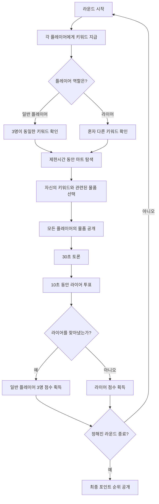

## 4시장에 가면 - 장르 : 추리
> [모티브 링크 A] https://youtu.be/oHcF4iAmEdY?si=XUyejD4B7-D7IgtZ  
> [모티브 링크 B] https://namu.wiki/w/%EC%8B%9C%EC%9E%A5%EC%97%90%20%EA%B0%80%EB%A9%B4

### 한 줄 소개
> 서로 다른 키워드를 받은 사실조차 모른 채 마트에서 연관 물품을 선택하고,
> 결과물을 비교해 라이어를 찾아내는 4인 추리 게임.

### 플레이 인원 / 시점
4인 / 2D 탑다운

### 핵심 재미
모든 플레이어가 자신의 키워드가 정상인지 알 수 없는 상황에서 다른 사람의 선택을 해석하고,
동시에 자신의 선택 역시 의심하게 되는 정보 비대칭을 핵심 재미로 삼는다.

### 네트워크
마트 내 플레이어 위치 동기화, 선택한 아이템 정보 공유,
채팅 및 투표 결과 전달을 서버 통신 요소로 활용할 수 있다.

### 상세
- `라이어 게임`과 `시장에 가면`을 결합한 형태이다. 게임 시작 전
  4명의 플레이어 중 3명은 동일한 키워드를 받고, 라이어 1명만 다른 키워드를 받는다.
  이후 대형 마트 안에서 자신이 받은 키워드와 관련 있다고 판단되는 물품을 선택한다.
  모든 플레이어는 본인이 라이어인지 여부를 알 수 없기 때문에 신중하게 물품을 고르게 된다.
- 플레이 예시
```
기본 키워드 : 스키장, 라이어 키워드 : 수영장
30초 동안 모든 플레이어가 물품을 선택한다.
<집어온 물품>
A : 장갑
B : 오뎅
C : 털모자
D : (수영)고글

이후 30초간 채팅을 통해 의견을 교환하고, 누가 다른 키워드를 받았는지 추리한다. 이후 10초 동안 투표를 진행한다.
라이어를 찾아내면 일반 플레이어 3명이 포인트를 획득하고, 찾아내지 못하면 라이어가 포인트를 획득한다.
정해진 횟수의 라운드를 진행한 뒤 누적 포인트를 기준으로 최종 순위를 결정한다.
```
- 클리어 조건
    - 일반 플레이어 3명: 라이어 찾아내기
    - 라이어: 정체를 들키지 않기
- 우려되는 점
    - 반복 플레이를 고려하면 충분히 다양한 아이템 구성이 필요할 것으로 보인다.
    - 게임 진행이 채팅과 투표에 크게 의존하므로, 프로그램 구성 자체가 단조롭게 느껴질 위험이 있다.
- 코어 루프
