# 시장에 가면 기술 문서

> **서로 다른 키워드를 받은 사실조차 모른 채 마트에서 물건을 고르고, 고른 물건과 발언으로 라이어를 찾아내는 멀티플레이 추리 게임**

| 항목 | 내용 |
|---|---|
| 장르 | 4인 멀티플레이 추리·심리전 파티 게임 (3D 탑다운) |
| 개발 기간 | 2026.08.18 ~ 2026.09.10 |
| 개발 인원 | 4인 팀 프로젝트 (**팀장**) |
| 개발 환경 | Unity 6000.3.15f1, C# |
| 담당 작업 | 팀장(일정 관리·작업 검토·빌드 테스트) · 게임 컨셉 기획 · UI 디자인 · 맵 디자인 · 기본 조명 제어 · 사운드 재생 구조 · TSV 데이터 작성 · 아이템 크기 조정 |
| 주요 기술 | enum·Dictionary 기반 사운드 관리 · Transform 기반 조명 제어 · BoxCollider Bounds 기반 매대 위치 계산 · TSV 데이터 테이블 |
| AI 활용 | 타이틀 화면 이미지 생성 (구도는 직접 스케치) · 바닥·벽 생성 도구 `RoomBuilder` 코드 생성 (→ 6) |
| 링크 | [GitHub](https://github.com/KooHoo-Dev/3rd-TeamProject-SH) · [시연 영상](https://youtu.be/9w9CUTdm4PU) · [숏폼](https://youtube.com/shorts/srYqEjIuvPg) |

> 4명이 함께 만든 게임입니다. 게임의 컨셉은 제가 기획했고, 팀장으로서 일정과 작업 흐름을 관리했습니다. 서버와 게임 진행, 데이터 로더는 팀원들이 만들었으며, 조명과 사운드처럼 함께 고친 부분은 누가 어디까지 했는지 절마다 나눠 두었습니다.
>
> 바닥·벽 생성 도구 `RoomBuilder`는 AI가 만든 코드를 가져다 쓴 것입니다(→ 6).

---

## 1. 개요

### 1.1 무엇을 만들었나

- 타이틀


**시장에 가면**은 마트에서 아이템을 선택하고 회의에서 토론하는 단계가 연결되는 4인 멀티플레이 게임입니다.

한 라운드는 장르·키워드 배정 → 마트에서 물건 고르기 → 회의실로 돌아와 발언 → 의심 가는 사람 지목 → 변론 → 투표와 결과 공개 순서로 진행됩니다.

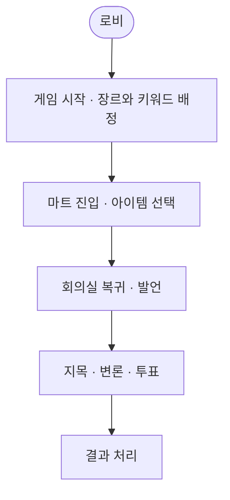

- 회의실
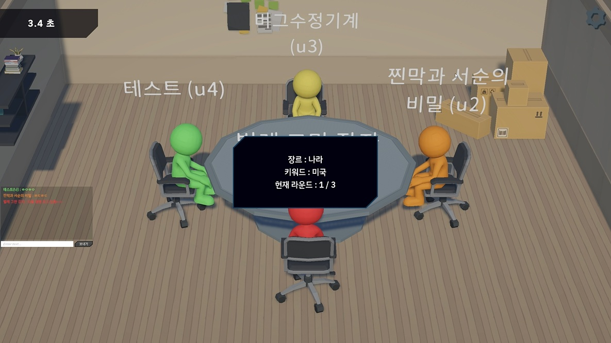
- 마트


| 구분 | 내용 |
|---|---|
| 게임 목표 | 마트에서 고른 물건과 발언을 단서로 키워드가 다른 한 명(라이어)을 찾아내기. 여러 라운드의 누적 점수로 최종 순위를 정함 |
| 플레이 인원 | 3명 이상이면 게임 시작 가능 (기획 기준 4인) |
| 일반 플레이어와 라이어의 차이 | 모두 같은 장르 안에서 키워드를 받고, 라이어 1명만 다른 키워드를 받음. 나머지 플레이어는 같은 키워드. **자신이 라이어인지 아무도 알 수 없음** |
| 승리 조건 | 라운드마다 점수를 정산하고, 모든 라운드가 끝난 뒤 누적 점수가 높은 순으로 순위 발표 (아래 점수 표) |
| 마트 규칙 | 라운드마다 서버가 정한 카테고리 3개가 마트의 세 구역에 하나씩 배정됨. 카테고리마다 물건을 1개씩 골라 맵 중앙의 상자에 넣어야 최종 선택으로 인정. 제한 시간 안에 고르지 못하면 랜덤 아이템이 주어짐. 다른 플레이어가 먼저 집은 물건은 집을 수 없음. 먼저 다 고른 플레이어는 마트를 돌아다니며 다른 플레이어를 밀쳐 방해할 수 있음 |
| 라운드 반복 규칙 | 라운드는 `회의실 → 마트 → 회의실` 순서. 회의는 카테고리 단위의 **사이클**로 반복하며, 사이클마다 `발언 → 지목 → 변론 → 투표 → 라이어 키워드 맞추기`를 진행. 기본 설정은 **3라운드 × 라운드당 3사이클** |
| 조작 방법 | WASD·방향키 이동 · F 아이템 집기/내려놓기 · Space 다른 플레이어 밀치기 · Tab(누르는 동안) 장르·키워드·발언 기록 확인 · Enter 채팅 입력 · 마우스로 UI 선택 |

**회의 사이클의 단계** (클라이언트 `Protocol.TurnMessageType` 기준)

| 단계 | 내용 |
|---|---|
| 발언 | 서버가 정한 순서대로 현재 발언자가 이번 카테고리에서 고른 물건을 보여 주며 특수 채팅으로 발언 |
| 지목 | 라이어로 의심되는 플레이어를 지목하거나 지목 스킵. 유효한 지목 결과가 없으면 다음 사이클로(마지막 사이클이면 다시 진행) |
| 변론 | 지목된 플레이어가 제한 시간 동안 일반 채팅으로 변론 |
| 투표 | 변론 대상에 대해 `라이어다`·`모르겠다`·`라이어가 아니다` 중 하나를 선택 |
| 라이어 키워드 맞추기 | 라이어가 일반 플레이어의 키워드를 추측해 입력 |
| 라밍아웃 | 발언 단계에서 버튼으로 "내가 라이어"라고 스스로 밝히는 특수 턴(`LiarSelfDisclose`). 실제 라이어면 바로 키워드 맞추기로 전환. 라이어가 아니면 **본인에게만** "라이어가 아니다"라는 문구가 뜨고, 다른 플레이어는 누른 사실을 알 수 없음 |

- 지목
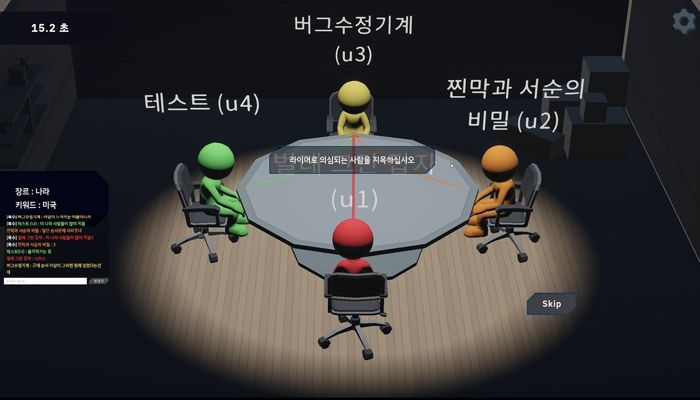

- 투표
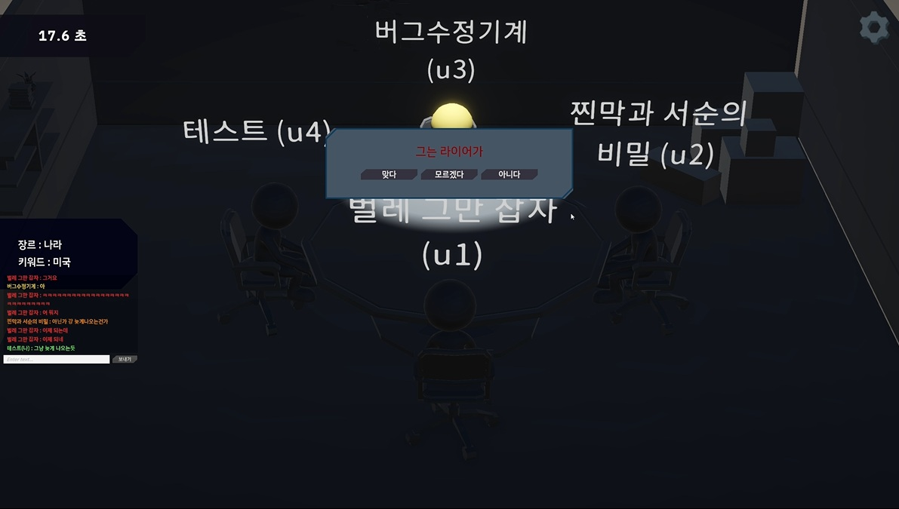

- 결과 공개
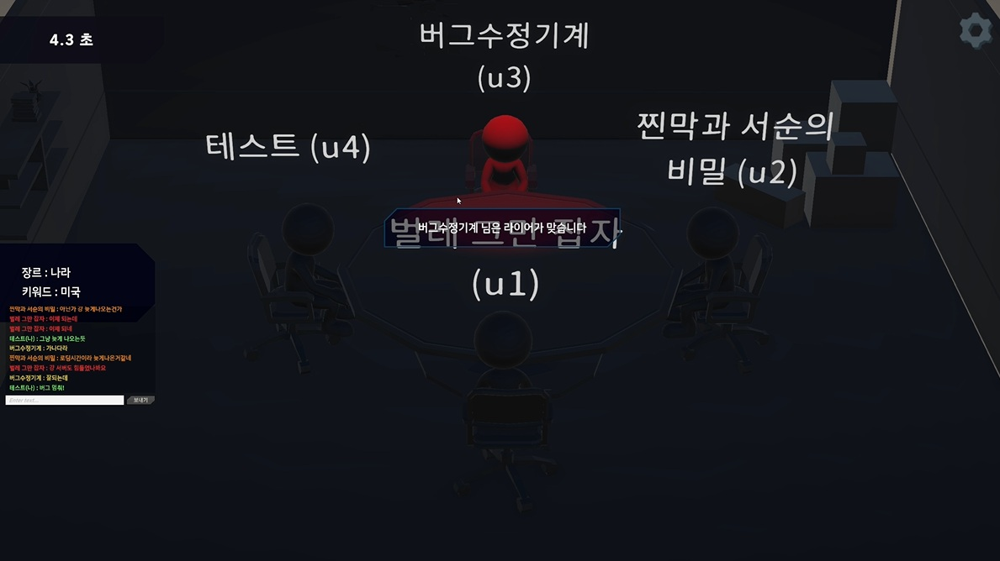

**제한 시간** (서버 기본 설정): 마트 100초 · 발언 30초 · 지목 30초 · 변론 20초 · 투표 20초 · 라이어 키워드 맞추기 20초

**점수** (서버 기본 설정)

| 상황 | 점수 |
|---|---|
| 라이어가 일반 키워드를 맞힘 | 라이어 +2 |
| 라이어가 키워드를 못 맞힘 | 일반 플레이어 +1 |
| 라이어가 투표 대상이 되지 않음 | 라이어 +1 |
| 투표 대상이 된 플레이어 | −1 |
| 투표 (대상이 실제 라이어일 때) | `라이어다` +1 · `모르겠다` 0 · `라이어가 아니다` −1 |
| 투표 (대상이 라이어가 아닐 때) | `라이어다` −1 · `모르겠다` 0 · `라이어가 아니다` +1 |
| 라밍아웃 — 실제 라이어 | 키워드를 맞히면 +2, 못 맞히면 −2 |
| 라밍아웃 — 라이어가 아닌 플레이어 | −1 |
| 마트 퀘스트 성공 | +1 |

점수는 0 아래로 내려가지 않습니다. 게임 진행·점수 계산은 모두 서버(팀원 담당)에서 처리합니다.

### 1.2 왜 만들었나

말 이어가기 놀이 「시장에 가면」에서 출발하였고, 게임 이름도 해당 놀이에서 따왔습니다. 이 놀이는 장소 하나를 정하면 돌아가며 그 장소와 관련된 물건을 말하고, 더 떠올리지 못하거나 앞에서 나온 물건을 제대로 기억하지 못하면 패배합니다.
여기에 라이어 게임을 결합해, **한 명에게만 다른 키워드를 주고 각자 키워드와 관련된 물건을 직접 집어 온 뒤 왜 집어 왔는지 설명 혹은 해명하게 하면** 재미있겠다는 생각으로 기획을 시작했습니다.

일반적인 라이어 게임에서는 라이어가 자신이 라이어라는 사실을 압니다. 이 게임은 **서로 다른 키워드를 받았다는 사실조차 모른 채** 마트에서 물건을 선택하게 하여, 라이어를 포함한 **모든 플레이어가 불확실성을 갖도록** 기획했습니다.

- 다른 플레이어의 선택을 해석하는 과정에서 **자신의 판단도 의심**하게 됩니다.
- 타 플레이어가 마트에서 어떤 물건을 골랐는지가 추리의 단서가 됩니다.
- 라이어 역시 자신의 정체를 확신할 수 없으므로, 스스로 마트에서 물건을 고를 때조차 신중하게 됩니다.

컨셉 기획 단계에서 정리한 예시는 다음과 같습니다.

```text
일반 키워드: 스키장 / 라이어 키워드: 수영장
고른 물건 — A: 장갑 · B: 오뎅 · C: 털모자 · D: (수영)고글
```

고글은 스키장과 수영장 어느 쪽에도 어울리므로, 물건만으로는 D가 라이어인지 단정할 수 없습니다. 고른 이유를 듣고 해석하는 과정이 필요합니다.

또한 마트에는 키워드와 정확히 들어맞는 물건이 반드시 있으리라는 보장이 없습니다. 플레이어에게는 키워드와 다소 거리가 있는 물건을 고를 수밖에 없는 상황 역시 주어질 수 있으며, 발언 단계에서 그 물건을 고른 이유를 **순발력 있게 설명하고 그럴듯한 근거를 붙여야** 합니다. 이 변명과 해석의 과정이 기존 라이어 게임과 구별되는 이 게임의 핵심 재미입니다.

### 1.3 팀 구성과 담당 범위

| 팀원 | 맡은 파트 |
|---|---|
| **본인 (팀장)** | 일정·작업 관리, 게임 컨셉 기획, UI·맵 디자인, 사운드·기본 조명, TSV 데이터 |
| 팀원 A | 서버 (게임 진행·점수 계산·메시지 처리) |
| 팀원 B | 클라이언트 — 회의실(라이어 게임) 진행과 UI 기능 연결 |
| 팀원 C | 클라이언트 — 마트 진행(캐릭터 이동·아이템 집기·밀치기) |

| 구분 | 담당 내용 | 팀원 작업과의 경계 |
|---|---|---|
| 팀장 | 작업 관리 도구 운영, 작업 검토·확인, 빌드 테스트(총 7회) 후 버그 목록 정리·분배 (→ 3) | 각 버그의 수정은 담당 팀원이 진행 |
| 기획 | 게임 컨셉 기획 (모두가 자신의 역할을 모르는 라이어 게임 + 마트 물건 선택) (→ 2) | 턴·투표 세부 루프와 서버 메시지 설계는 팀원 담당 |
| UI | 로비·회의실·투표·튜토리얼 등의 화면 디자인 작업 | 서버 상태에 따른 UI 갱신 로직과 구분 |
| 맵 | 로비·회의실·마트 공간 디자인과 배치 작업 | 게임 진행·아이템 배정 로직과 구분 |
| 사운드 | BGM·SFX 분리, enum과 클립 매핑, 재생 메서드 | 볼륨 조절과 `PauseBGM()`은 팀원 수정 영역 |
| 조명 | 초기 조명 설정, 발언자 위치에 따른 기본 스포트라이트 제어 | DOTween 밝기 연출·라이어·승자 조명은 팀원 확장 |
| 데이터 | 아이템·장르·키워드 TSV 작성 및 수정 | TSV 파싱과 게임 데이터 로딩은 팀원 담당 |
| 아이템 | 카테고리별 아이템 크기 조정 | 외부 모델 자체 제작과 구분 |

이 문서는 **내 기획이 팀의 게임이 되기까지(2)**, **팀장으로서 일정과 작업을 운영한 방식(3)**, **담당 기능 구현(4)**, **협업 중 생긴 문제(5)** 순서로 기술합니다.

---

## 2. 기획 — 내 컨셉이 팀의 게임이 되기까지

### 2.1 컨셉 기획서 — 처음 내가 짠 것

팀원 모두가 개수 제한 없이 기획안을 내고, 투표로 후보를 추린 결과 선정된 것이 **시장에 가면**이었습니다. 처음에는 구체적인 시스템 설계 없이 간단한 컨셉 기획서 한 장이 제가 짠 기획의 전부였습니다.

| 항목 | 컨셉 기획서 |
|---|---|
| 한 줄 소개 | 서로 다른 키워드를 받은 사실조차 모른 채 마트에서 연관 물품을 선택하고, 결과물을 비교해 라이어를 찾아내는 4인 추리 게임 |
| 플레이 인원 / 시점 | 4인 / 2D 탑다운 |
| 핵심 재미 | 모두가 자신의 키워드가 정상인지 모르는 상황에서 다른 사람의 선택을 해석하고, 동시에 자신의 선택도 의심하게 되는 정보 비대칭 |
| 네트워크 요소 | 마트 내 플레이어 위치 동기화, 선택한 아이템 정보 공유, 채팅과 투표 결과 전달 |
| 우려되는 점 | ① 반복 플레이를 위해 아이템 구성이 충분히 다양해야 함 ② 진행이 채팅과 투표에 크게 의존해 단조로울 수 있음 |

**컨셉 기획서의 코어 루프**

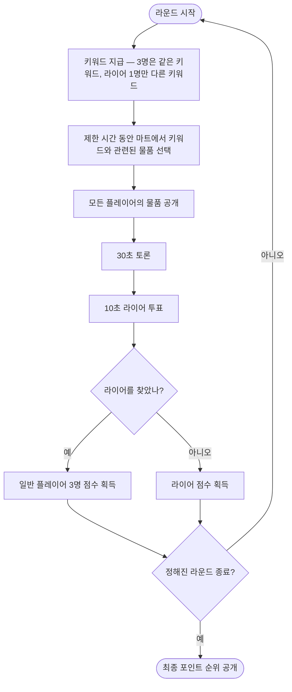

게임으로 만들려면 구체적인 규칙이 더 필요했으므로, 선정 뒤에는 팀원들과 토론하며 규칙을 채웠습니다.

### 2.2 팀 토론으로 규칙 구체화하기

| 항목 | 컨셉 기획서 | 토론 후 | 누가 · 왜 |
|---|---|---|---|
| 시점 | 2D 탑다운 | 3D 탑다운 | 과제가 2D 팀 프로젝트(3D 허용)여서 처음에는 2D로 썼으나, 3D가 훨씬 능동적으로 보일 것 같다는 데 나와 팀원들 모두 동의 |
| 회의 진행 | 물품 공개 → 30초 토론 → 10초 투표 | 한 명씩 차례로 발언하고, 지목·변론·투표로 라이어를 가려냄 | 레퍼런스 [Liar Game (Steam)](https://store.steampowered.com/app/3555700/Liar_Game/?l=koreana)의 진행 방식을 참고 |
| 마트의 변수 | 물품 선택만 있음 | **밀치기** · **개인 퀘스트** 추가 | 밀치기는 본인 제안, 개인 퀘스트는 팀원 제안 — 우려 ②에 대한 대응 |

- **밀치기:** 직접 멀티플레이 게임을 하면서, 오버워치처럼 같은 팀임에도 일부러 다른 플레이어의 길을 막거나 가만히 있는 플레이어를 슬쩍 밀어 떨어뜨리는 식의 가벼운 방해를 즐기는 사람이 많다는 것을 체감했습니다. 따라서 서로를 밀칠 수 있는 기능이 있다면 좋겠다는 판단을 하였습니다. 해당 기능을 마트에 넣은 목적은 두 가지입니다.
  - 마트에서 물건을 먼저 다 고를 때 생길 수밖에 없는 빈 시간을 지루하지 않게 보내게 합니다.
  - 밀치기를 물건 고르기보다 더 즐기는 주객전도를 노렸습니다. 시간 안에 물건을 고르지 못하면 랜덤 아이템을 들고 가게 되고, 회의실에서 그 물건을 해명하느라 진땀을 빼는 상황이 생깁니다.
- **개인 퀘스트:** 수행하면 점수를 얻지만, 키워드와 관련 없는 물건을 고를 가능성이 높아집니다. 해당 물건 때문에 라이어로 의심받으면 스스로 해명해야 합니다. 점수와 의심이라는 장단점을 함께 주는 선택입니다.

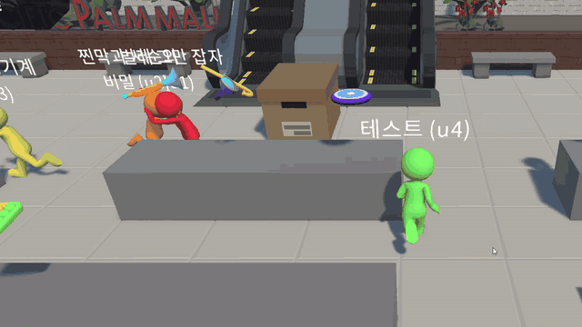

**레퍼런스와 다른 점**

| 레퍼런스와 다른 점 | 내용 |
|---|---|
| 모두가 자신의 역할을 모름 | 라이어도 자신이 라이어인지 알 수 없음 |
| 마트에서 물건 고르기 | 말뿐 아니라 마트에서 고른 물건이 추리의 단서가 됨 |
| 순발력 있는 변명 | 키워드와 딱 맞는 물건이 없어도, 고른 물건에 그럴듯한 이유를 붙여 설명해야 함 |

**우려에 대한 대응의 결과**

| 컨셉 기획 때의 우려 | 결과 |
|---|---|
| ① 아이템 구성의 다양성 | 해결하지 못함. 아이템 가짓수가 부족하다는 피드백을 받음 (→ 7.3) |
| ② 채팅·투표에 의존한 단조로움 | 함께 수강한 동료들의 플레이 테스트 피드백에서 밀치기가 특히 좋은 평가를 받았고, 실제 플레이에서도 서로 열심히 밀치며 방해를 즐기는 모습을 확인. 개인 퀘스트 때문에 생뚱맞은 물건을 고른 플레이어가 해명하는 장면이 웃음을 만드는 것도 확인 |

### 2.3 토론에서 정한 규칙과 실제 구현의 차이

| 항목 | 토론에서 정한 규칙 | 실제 구현 | 바꾼 이유 |
|---|---|---|---|
| 회의 진행 | 물건 공개 → 토론 → 원할 때 조기 투표 | 사이클마다 발언 → 지목 → 변론 → 투표 → 키워드 맞추기를 고정 순서로 진행 | 레퍼런스로 삼은 라이어 게임의 진행 방식을 따름. 한 명씩 **공평하게 발언권**을 주는 것이 타당하다고 판단 |
| 투표 | 라이어 지목 투표 → 변론 → 확정 재투표 | 지목(또는 지목 스킵) → 변론 → `라이어다`·`모르겠다`·`라이어가 아니다` 투표 | 레퍼런스 라이어 게임의 투표 방식을 따름. `모르겠다`를 두어 확신 없는 플레이어가 **무작정 찍지 않도록** 함 |
| 자진 라이어 선언 | 회의 중 언제든 버튼으로 선언 | 발언 단계에서만 라밍아웃 버튼 활성화 | 아무 때나 누를 수 있으면 **게임 흐름을 계속 끊을** 수 있어 시점을 제한 |
| 점수 | 이른 사이클에 라이어를 맞힐수록 높은 점수 | 사이클과 관계없이 정해진 점수, 투표 선택별 점수 (1.1 점수 표) | 개발 기간 안에 완성하기 위해 타협 (→ 3.4) |
| 카테고리 잠금 | 마트 진입 시 카테고리 구역 1개를 잠가 선택 불가 | 넣지 않음 | 구현할 것이 많은 상황에서 꼭 필요한 기능이 아니라고 회의에서 결정 (→ 3.4) |
| 선택을 마친 뒤 | 먼저 고른 플레이어가 다른 플레이어를 관전하는 기능 검토 | 마트를 돌아다니며 다른 플레이어를 밀쳐 방해 | 기다리는 동안에도 직접 참여할 여지를 두기 위함 (2.2 밀치기) |

---

## 3. 일정과 진행 방식 — 팀장으로서

### 3.1 작업 관리 규칙

작업은 작업 관리 도구(Asana)의 보드로 관리했습니다. 보드의 단계, 기능 영역(에픽) 나누기, 작업 이름 앞의 머리말(`[서버]`·`[UGUI]`·`[맵]` 등) 규칙은 팀장인 제가 정했습니다.

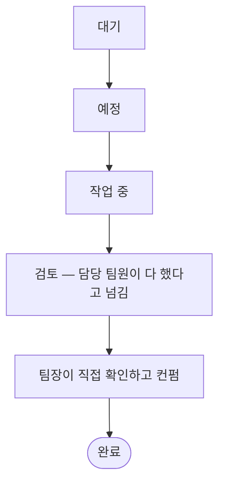

| 규칙 | 내용 |
|---|---|
| 기능 영역 | 비슷한 목적의 작업을 E1 ~ E13으로 묶음 (예: E5 채팅·발언·변론, E10 마트 아이템 & 공유 가방) |
| 업무 배분 | 에픽·백로그 회의(08.21)에서 업무 배분과 큰 갈래의 작업을 정함 |
| 검토 | 팀원이 작업을 검토 단계로 넘기면, 내가 직접 확인하고 컨펌해야 완료 |
| 소통 | 작은 단위의 작업도 즉각적인 소통이 필요했기에 디스코드 채팅·음성에 상시 대기하며, 의논할 일이 생기면 바로 이야기함 |

- 보드의 단계별 작업 흐름
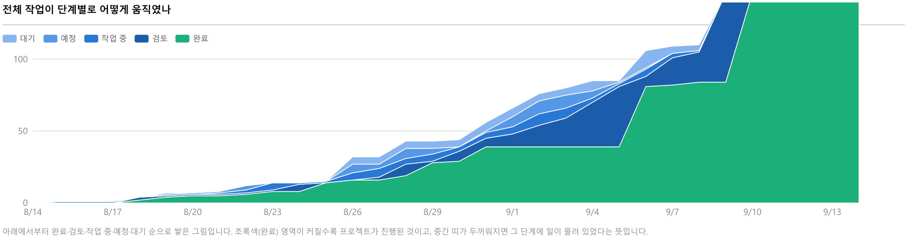

### 3.2 일정 흐름

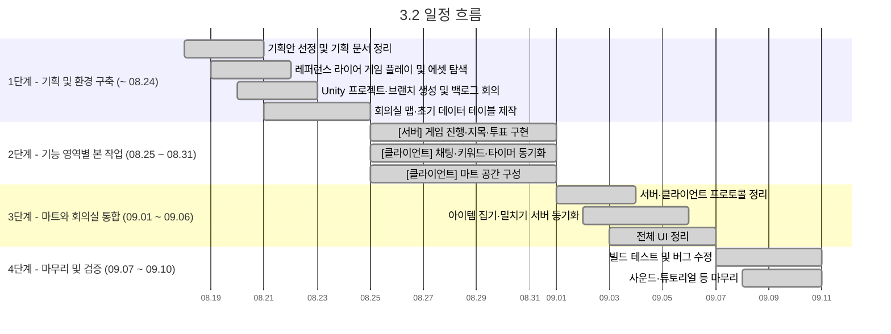

**기간별 계획과 실제** (보드에 올린 작업 146개를 시작일로 묶음. 계획은 작업에 정해 둔 목표일, 실제는 완료일)

| 기간 | 작업 | 계획 (목표일) | 실제 |
|---|---|---|---|
| ~ 08.24 | 14개 | 12개에 목표일 (08.16 ~ 08.24) | 12개 중 10개가 목표일 안에 완료. 마지막 완료 08.25 |
| 08.25 ~ 08.31 | 42개 | 38개에 목표일 (주로 08.30) | 16개가 목표일 안, 22개는 늦게 완료 — 대부분 1일, 가장 늦은 것도 2일 |
| 09.01 ~ 09.06 | 50개 | 23개에 목표일 (09.02 · 09.04) | 2개가 목표일 안, 21개는 늦게 완료 — 대부분 1일, 가장 늦은 것은 6일 |
| 09.07 ~ 09.10 | 40개 | 목표일 없이 마감(09.10)까지 | 40개 모두 마감 안에 완료 |

통합 단계(09.01 ~ 09.06)에서는 목표일을 정한 작업 대부분이 늦어졌지만, 늦어진 폭은 대부분 하루였고 전체 마감은 지켰습니다(→ 3.4).

**일정 기록으로 본 결과** (작업 관리 도구와 코드 저장소 기록 기준)

| 항목 | 값 |
|---|---|
| 전체 작업 | 198개 중 191개 완료 (96%) |
| 목표일 안에 완료 | 191개 중 145개 (76%) |
| 처음 계획한 작업 (08.26 기준) | 32개 — 모두 완료 |
| 진행하면서 새로 생긴 작업 | 114개 (처음 계획의 356%) |
| 본인 담당 작업 | 37개 모두 완료 |

- 할 일과 끝낸 일
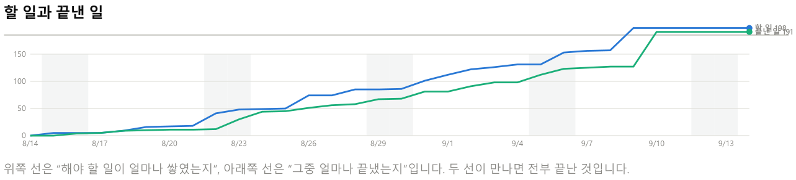

### 3.3 계획보다 늘어난 일

새로 생긴 작업 114개 중 가장 큰 몫은 **UI/UX 작업 33개**였으며, 이 영역은 처음 계획에 하나도 없었습니다.

- 처음 계획과 새로 생긴 일
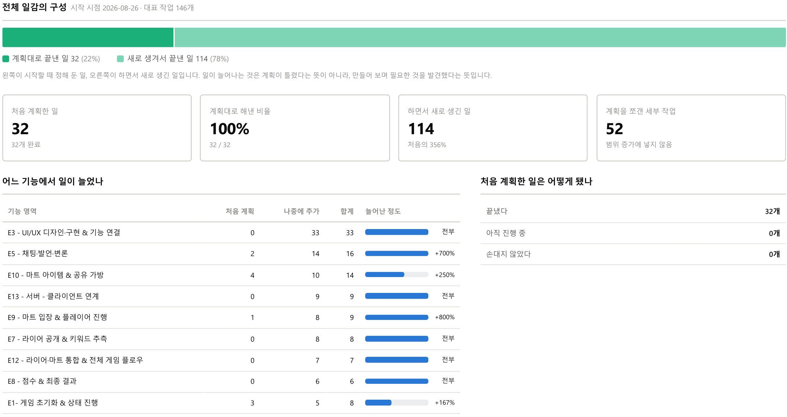

실제로 게임을 만들고 테스트하다 보면 필요한 UI가 계속 생깁니다. 그래서 팀원에게는 **"필요한 UI는 기능만 동작하게 일단 넣어 두면, 디자인은 내가 하겠다"**고 정했습니다. 팀원이 "이런 UI를 넣었다"고 알려 오면 그때마다 그 UI를 다듬는 내 작업이 새로 생긴 것입니다. 이 방식에서 생긴 문제는 5.2에 적었습니다.

### 3.4 늦어진 작업과 줄인 범위

목표일을 넘긴 작업은 24%였습니다. 팀원들은 자기가 할 일을 알면 바로 시작해 마무리하고 다음 일로 넘어가는 방식으로 일했고, 날짜를 칼같이 맞추는 편은 아니었습니다.

그래서 저는 개별 작업의 목표일보다 **최종 일정에 무리가 없는지**를 기준으로 삼았습니다. 작업 현황을 계속 확인하면서 마감에 영향이 없는 정도의 지연은 넘어갔습니다. 실제로 늦어진 작업도 대부분 하루 안에 끝났습니다(3.2 기간별 계획과 실제).

범위를 줄인 결정(사이클별 점수 차등, 카테고리 구역 잠금)은 따로 날을 잡아 정하지 않고, 개발을 진행하면서 자연스럽게 제외했습니다. 무엇을 왜 뺐는지는 2.3에 정리했습니다.

### 3.5 브랜치 병합 방식

처음에는 팀원별 브랜치를 자주 합치지 않았습니다. 그러다 충돌이 크게 날 뻔한 일이 있은 뒤로는, **기능 하나를 끝낼 때마다 바로 메인에 병합**하는 방식으로 바꿨습니다.

충돌 해결도 처음에는 직접 맡으려 했습니다. 하지만 본인이 작업한 부분은 본인이 가장 잘 알기 때문에, **충돌이 난 당사자들이 서로 협의하고 합치는** 방식으로 정했습니다.

### 3.6 빌드 테스트

마감 직전에 빌드 테스트를 **총 7회** 진행했습니다. 매 회차 한 라운드 전체를 플레이하며 발생한 버그를 모두 기록·정리했고, 담당자가 이를 가져가 수정·커밋하는 방식으로 운영했습니다.

---

## 4. 담당 기능 구현

### 4.1 담당 기능과 팀 시스템의 연결

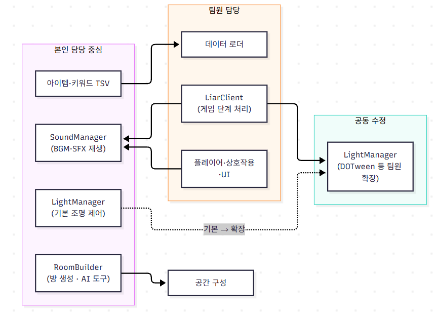

사운드는 팀원 코드가 필요한 소리의 이름(enum)만 넘기면, `SoundManager`가 맞는 클립을 찾아 재생합니다. 조명은 제가 만든 기본 제어(`LightManager`) 위에 팀원이 DOTween 연출 등을 더해 함께 수정한 파일입니다(범위 → 4.3).

### 4.2 enum 기반 공용 사운드 관리

호출하는 쪽은 오디오 클립을 직접 참조하지 않고, 상황에 맞는 enum 값만 전달하면 됩니다.

```csharp
// 호출 예시 — 팀원 코드에서 사용하는 형태
SoundManager.Instance.PlayBGM(SoundManager.GameBGM.Mart);
SoundManager.Instance.PlaySfx(SoundManager.GameSfx.ItemPickUp);
```

`InitDictionaries()`는 Inspector에 등록한 배열을 enum 키의 Dictionary로 변환하고, 재생 요청 시에는 `TryGetValue()`로 클립을 조회합니다.

```csharp
private void InitDictionaries()
{
    bgmDict = new Dictionary<GameBGM, AudioClip>();
    for (int i = 0; i < bgmClips.Length; i++)
    {
        bgmDict[(GameBGM)i] = bgmClips[i];
    }

    sfxDict = new Dictionary<GameSfx, AudioClip>();
    for (int i = 0; i < sfxClips.Length; i++)
    {
        sfxDict[(GameSfx)i] = sfxClips[i];
    }
}
```

따라서 호출하는 코드에는 `ItemPickUp`, `VoteButtonClick`과 같이 상황 이름만 남으며, 어떤 클립을 연결할지는 사운드 매니저 한 곳에서만 변경하면 됩니다.

| 방법 | 장점 | 단점 |
|---|---|---|
| **A. enum으로 호출 (선택)** | IDE 자동 완성(Tab)으로 바로 고를 수 있고, 없는 이름은 컴파일 단계에서 걸러짐 | enum과 Inspector 클립 배열의 순서를 맞춰야 하고, 틀려도 Dictionary 생성 시점에 검출하지 않음 |
| B. 문자열 이름으로 호출 | 클립 이름을 그대로 쓰면 되어 따로 enum을 만들 필요가 없음 | 오타가 실행 중에야 드러나고, 어떤 이름이 있는지 호출하는 쪽에서 알기 어려움 |

→ 사운드를 호출하는 쪽이 대부분 팀원 코드였기 때문에 **Tab 자동 완성으로 쉽게 고를 수 있는 enum이 모두에게 편하다**고 판단했습니다.

**BGM과 SFX 분리:** 처음에는 AudioSource 하나로 BGM과 SFX를 함께 재생했으나, 이 방식으로는 BGM과 효과음의 음량을 **따로 조절할 수 없었습니다.** 그래서 AudioSource를 BGM용(`loop = true` 반복 재생)과 SFX용(`PlayOneShot()` 단발 재생)으로 나누었고(커밋 `1c8a9e85`), 이후 각각을 자식 오브젝트로 분리했습니다(커밋 `773525a3`).

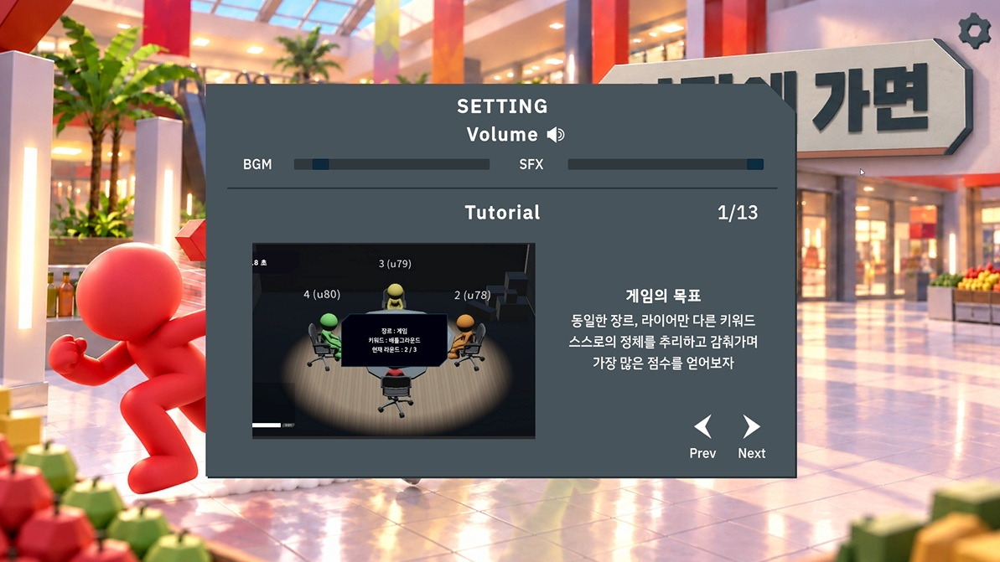

**목표한 경험과의 연결:** 마트는 물건을 고르고 다른 플레이어를 밀치는 가벼운 구간이라 발랄한 BGM을, 회의실은 스스로 의심받지 않으면서 다른 플레이어를 의심해야 하는 구간이라 긴장감 있는 BGM을 두었습니다.

**공동 작업 범위:** 볼륨 조절 메서드와 관련 UI 연결, `PauseBGM()`은 팀원 작업입니다.

### 4.3 발언자 위치에 따른 기본 조명 제어

발언자의 Transform을 받으면 주변 조명을 어둡게 하고, 해당 플레이어 위로 스포트라이트를 이동시킵니다.

**목표한 경험과의 연결:** 지금 누가 발언하고 있는지를 텍스트뿐 아니라 시각적·공간적으로도 알 수 있게 하려 했습니다.

```csharp
public void TurnOnSpotLight(Transform currentSpeaker)
{
    directionalLight.intensity = zeroIntensity;
    RenderSettings.ambientIntensity = zeroIntensity;

    spotLight.transform.position =
        new Vector3(
            currentSpeaker.position.x,
            10f,
            currentSpeaker.position.z
        );

    spotLight.enabled = true;
}
```

누가 발언자인지는 조명 매니저가 결정하지 않습니다. 발언 순서는 게임 진행 코드가 결정하며, 조명은 전달받은 Transform의 위치를 비추는 역할만 수행합니다.

**본인 담당:** 초기 조명 설정(`InitLights()`)과 기본 스포트라이트 제어(`TurnOnSpotLight()`·`TurnOffSpotLight()`).
**팀원 확장:** DOTween 밝기 변화, 테이블 포커스, 라이어 색상 연출, 복수 승자 조명. 최종 게임의 발언자 연출에는 팀원이 확장한 `TurnOnDotween()`을 사용합니다.

- 발언 단계
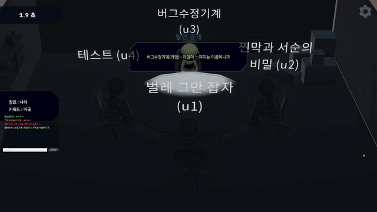

### 4.4 TSV 데이터 작성과 아이템 연결

아이템과 키워드 정보는 `Assets/StreamingAssets/Table` 아래 TSV 파일로 관리합니다.

- 장르·키워드 표

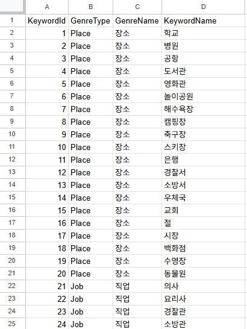

- 카테고리·아이템 표
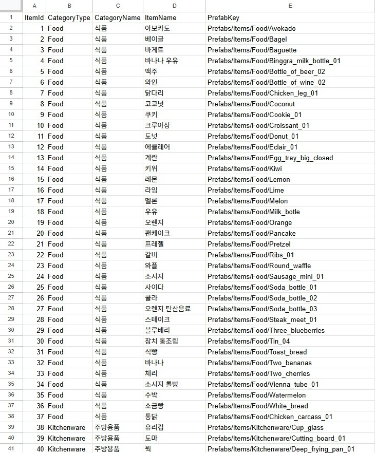

| 파일 | 구성 |
|---|---|
| `genre_keywords.tsv` (`KeywordId`, `GenreType`, `GenreName`, `KeywordName`) | 12개 장르 × 장르당 20개 키워드 = 240개 (동물·색깔·나라·게임·명절·기념일·직업·영화·장소·스포츠·과목·교통수단·별자리) |
| `category_items.tsv` (`ItemId`, `CategoryType`, `CategoryName`, `ItemName`, `PrefabKey`) | 6개 카테고리, 176개 아이템 — 식품 37 · 주방용품 27 · 생활용품 21 · 문구 18 · 공구 21 · 완구/레저 52 |

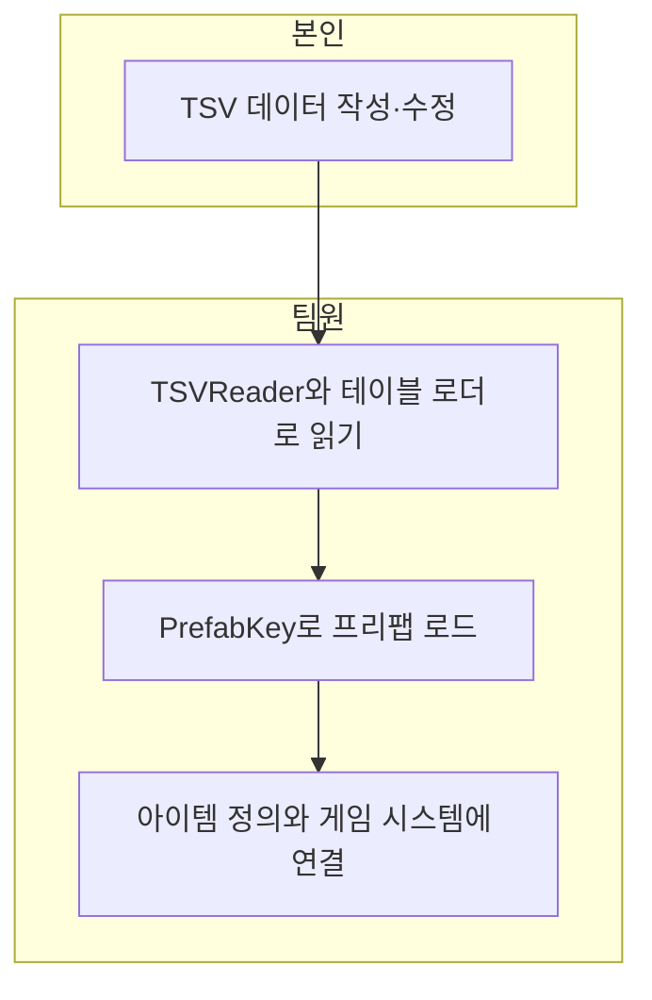

팀원의 `ItemTable.Load()`가 `PrefabKey`를 그대로 `Resources.Load<MartItem>()`에 전달하기 때문에, 표에 기록한 경로가 Resources 내부의 실제 프리팹 경로와 일치해야 합니다. 또 카테고리 로더는 직전 행과 카테고리가 달라지는 지점에서 항목을 구분하여 읽으므로, 같은 카테고리의 행은 반드시 연속으로 기록했습니다.

| 표 | 작성 기준 |
|---|---|
| 장르 | 키워드를 들었을 때 **마트 물건이 연상되기 좋은** 장르 |
| 카테고리 | 실제 마트에 있을 법한 물건으로 구성 |

### 4.5 UI·맵 디자인과 매대 배치

| 작업 | 구체적인 내용 |
|---|---|
| UI 디자인 | 가독성과 **보기 편한지**를 가장 중요하게 보고, UX 중심으로 배치·수정 |
| 맵 디자인 | 매대를 동선의 **중앙**에 두고, 카테고리 구역마다 매대를 **세 줄**로 배치해 같은 카테고리의 아이템이 한 공간에 모이게 함 |
| 아이템 크기 조정 | **캐릭터 크기를 기준**으로, 실제로 이 정도 크기여야 설득력 있다고 느껴지도록 카테고리별 스케일 조정 (→ 5.3) |

- 마트 전경


- 매대와 아이템


- 로비


- 설정·튜토리얼


**구역 크기에 따른 매대 위치 계산:** `CategoryAreaManager`에서 구역마다 매대 3개를 자동으로 생성하도록 했습니다. BoxCollider의 Z축 길이를 3등분하여 각 구간의 중앙에 매대를 배치합니다. 매대 하나에 아이템을 **세 개씩** 올리자는 방향도 이때 정했습니다(이 결정이 협업에서 만든 문제 → 5.1).

```csharp
private void GetDisplayStandPosition()
{
    BoxCollider boxCollider = GetComponent<BoxCollider>();
    areaLength = boxCollider.bounds.size.z;
    float startPoint = boxCollider.bounds.min.z;
    float dividedLength = areaLength / DisplayStandMaxCount;

    for (int i = 0; i < DisplayStandMaxCount; i++)
    {
        float z = startPoint
            + dividedLength * i
            + dividedLength * 0.5f;

        Vector3 position =
            new Vector3(boxCollider.bounds.center.x, 0f, z);

        displayStandPositions.Add(position);
    }
}
```

| 시점 | 내용 |
|---|---|
| 초기 (커밋 `de0c8f36`, 08-28) | 구역마다 `CategoryAreaManager`를 두고, 테스트 키(Q)로 매대 3개를 자동 생성 |
| 최종 (커밋 `fff1c3d6`, 09-03) | 마트 맵을 업데이트하면서 매대를 씬에 **직접 배치**하고, 자동 생성 테스트 호출은 주석 처리 |

따라서 최종 마트 씬의 매대는 이 코드로 생성된 것이 아닙니다. 동선과 보기 좋은 구성은 **눈으로 확인하며** 옮겨야 했기 때문입니다. 또 이 계산은 월드 좌표 Bounds를 사용하고 Y를 0으로 고정했기 때문에, 구역이 회전되어 있거나 높이가 다르면 정확한 위치를 산출하지 못합니다.

---

## 5. 협업 이슈

### 5.1 매대 하나에 아이템 몇 개? — 서로 당연하다고 여긴 설계

| 구분 | 내용 |
|---|---|
| **상황** | 서버 수업을 듣기 전에 작업을 미리 조금씩 시작했기 때문에, 서버를 누가 맡을지 정해지지 않은 상태였습니다. 그래서 초기 마트 작업을 한 팀원 A가 그대로 서버 담당이 되었고, 제가 맵 디자인을 위해 마트 파트를 일부 이어 받아 정리했습니다. |
| **문제** | 작업을 진행하며 **매대 하나에 아이템 여러 개**를 올리는 방식으로 틀 자체를 바꿔 두었습니다(→ 4.5). 그러나 마트를 맡게 될 팀원 C는 명품 목걸이 전시 매대처럼 **매대 하나에 아이템 하나**를 생각하고 있었습니다. 서로 당연하다고 여겨 논의 자체가 없었습니다 |
| **원인** | 담당이 바뀌는 시점에 설계를 맞추는 대화 없이, 당연하다고 생각한 방식으로 작업을 진행했습니다 |
| **결과** | 이후 제가 디자인 쪽으로 완전히 빠지면서, 팀원 C가 팀원 A가 짠 코드와 제가 틀을 바꾼 코드 두 가지를 보며 합치고 서버와 주고받을 수 있게 고쳐야 했습니다. 이 과정에서 팀원 모두가 머리를 맞대고 고생했습니다 |
| **배운 점** | 당연해 보이는 설계일수록 말로 확인해야 하며, 본인이 인계하는 작업은 다음 사람이 이어받을 수 있게 방향을 맞춰 두고 넘겨야 한다는 것을 배웠습니다. |

### 5.2 "기능 먼저, 디자인은 나중에" — 두 갈래로 갈린 UI 구현

| 구분 | 내용 |
|---|---|
| **상황** | 필요한 UI는 팀원이 기능만 동작하게 먼저 넣고, 디자인은 제가 다듬기로 했습니다(→ 3.3) |
| **문제** | 마트 담당(팀원 C)과 회의실 담당(팀원 B)이 각자 UI를 만들면서 **UI를 구현하는 방식이 서로 달라졌습니다** |
| **대응** | 두 곳에 공통으로 쓰이는 UI는 마트 담당·회의실 담당·UI 담당인 저까지 해서 세 명이 의논해 통일할 수 있는 것은 통일했습니다 |
| **남은 문제** | 완전히 통일하지는 못해, 지금도 두 갈래가 약간 다른 방식으로 동작합니다 |

### 5.3 내 작업이 팀원 코드에 준 영향 — 아이템 스케일

| 구분 | 내용 |
|---|---|
| **문제** | 아이템을 회전시키거나 다른 동작을 적용할 때 의도와 다르게 움직여, 해당 기능을 맡은 팀원이 이를 처리하느라 고생했습니다 |
| **원인** | 아이템 크기를 맞추면서 프리팹의 Transform 스케일을 `(1, 1, 1)`이 아닌 값으로 직접 바꿨습니다. 스케일은 가급적 `(1, 1, 1)`로 두어야 한다는 것을 3D를 제대로 공부하고 시작한 것이 아니었던 만큼 인지하지 못했습니다. |
| **해결** | 담당 팀원이 해당 기능 쪽에서 수정했습니다 |
| **결과·배운 점** | 팀원이 수정한 뒤 아이템의 회전·배치가 제대로 동작했습니다. 보기 좋은 크기만 맞추면 될 줄 알았지만, 스케일 값이 다른 사람의 코드(회전·배치)에 영향을 준다는 것을 알게 되었습니다. 다음에는 모델 자체 크기나 자식 오브젝트로 크기를 맞추고 루트 스케일은 `(1, 1, 1)`로 유지해야겠다고 생각했습니다. |

### 5.4 공용 기능을 팀원에게 넘기는 방식

사운드·조명·데이터처럼 팀원 모두가 쓰는 기능은, 팀원이 필요한 매니저 하나만 알면 호출할 수 있도록 호출 규칙을 단순하게 정해 공유했습니다.

| 매니저 | 팀원에게 공유한 호출 규칙 |
|---|---|
| `SoundManager` | 상황에 맞는 **enum 이름만 넘기면** 재생됩니다 (`PlaySfx(GameSfx.ItemPickUp)`) |
| `LightManager` | 발언 차례가 돌아올 때 **해당 플레이어의 Transform만 넘기면** 그 위치에 스포트라이트가 켜집니다 |

저는 **기본 기능**까지만 구현하고, 서버와 주고받는 처리나 초기화 로직처럼 각 파트에 맞춰야 하는 부분은 해당 파트를 맡은 팀원이 판단해 보완하도록 나누었습니다. 볼륨 조절이나 조명 DOTween 연출처럼 UX·연출에 필요한 기능도 팀원이 자율적으로 추가했습니다.

---

## 6. AI 결과물을 확인하고 고친 과정

AI는 **타이틀 이미지**와 **바닥·벽 생성 도구**(`RoomBuilder`) 두 곳에 사용했습니다. 두 경우 모두 결과를 직접 확인하고, 의도와 다른 부분은 다시 요청하거나 직접 고쳤습니다.

| 대상 | 요청 방식 | 확인 방법 | 의도와 달랐던 점 | 대응 |
|---|---|---|---|---|
| 타이틀 이미지 (ChatGPT) | 처음에는 구도와 동작을 글로만 설명 | 생성된 이미지를 직접 보고 판단 | 손이 여러 차례 어색하게 생성됨 | 구도와 동작을 직접 스케치해 무엇이 문제이고 어떤 결과를 원하는지 보여 주자, 그제서야 의도대로 나옴 |
| `RoomBuilder` | 프리팹을 컴포넌트에 넣고 가로·세로 개수를 정하면 바닥·벽이 깔리도록 요청 | 먼저 실행해 의도대로 생성되는지 확인 | 벽과 바닥 사이에 틈이 생김 | 만들 방이 회의실과 마트 두 개뿐이라, 도구를 고치기보다 씬에서 직접 보며 수정 |

`RoomBuilder`로는 회의실과 마트의 바닥·벽만 만들었습니다(로비는 회의실과 같은 공간을 사용). 바닥·벽 같은 단순 반복 작업은 도구에 맡기고, 공간 구성과 동선처럼 판단이 필요한 배치에 시간을 쓰기 위해서였습니다.

- 타이틀 구도 스케치
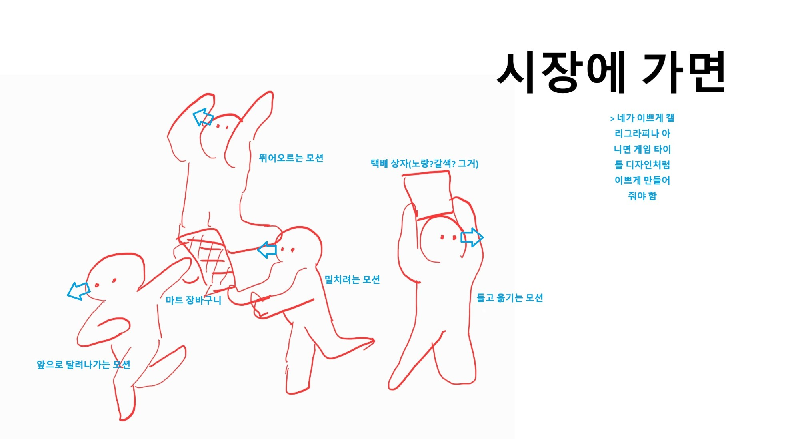

이미지는 글로 설명을 반복하는 것보다, 직접 그린 스케치로 원하는 결과를 보여 주는 편이 효과적이었습니다.

---

## 7. 결과 및 배운 점

### 7.1 결과

- 제 컨셉 기획이 기한 내에 팀의 게임으로 완성되었습니다. 모두가 자신이 라이어인지 모르는 데서 오는 불확실성과 긴장감을 실제 플레이에서 확인했습니다.
- 핵심 재미로 삼은 변명과 해석도 함께 수강한 동료들의 플레이 장면에서 확인했습니다. 키워드와 거리가 있는 물건을 고른 플레이어가 그 이유를 해명하고, 다른 플레이어들이 그 설명을 듣고 의심하며 해석하는 모습이 실제로 나타났습니다.
- **팀의 결과:** 팀 전체 작업 198개 중 191개(96%)를 마쳤고, 처음 계획한 작업은 모두 끝냈습니다.
- **내 기여:** 제가 만든 기능은 실제 게임에서 다음과 같이 쓰였습니다.
  - 공통 사운드 API(`SoundManager`)를 게임 진행·플레이어·UI 코드에서 호출 (→ 4.2)
  - 발언자 Transform을 받는 기본 조명 제어 위에 팀원이 연출을 더해 최종 발언자 연출로 사용 (→ 4.3)
  - TSV에 작성한 장르·키워드 240개와 아이템 176개를 팀원의 데이터 로더가 읽어 게임에 연결 (→ 4.4)
- 다만 아이템 가짓수가 부족하다는 피드백이 있었습니다(→ 7.3).

### 7.2 트러블슈팅: Enter 입력으로 설정창이 열리는 문제

| 구분 | 내용 |
|---|---|
| **문제** | 채팅을 입력하고 Enter를 누르면, 채팅이 전송되는 대신 **설정창이 열림** |
| **원인** | 설정 버튼(`SettingsButton`)의 Navigation이 `Automatic`으로 되어 있어, 키보드 입력으로 선택이 설정 버튼으로 옮겨진 상태에서 Enter(Submit)가 버튼 클릭으로 처리됨 |
| **해결** | 공통 UI 프리팹(`CommonUI`)에서 `SettingsButton`의 Navigation을 `None`으로 변경 (커밋 `3b830a02`). 다음 날 같은 문제가 생길 수 있는 다른 버튼들의 Navigation도 함께 끔 (커밋 `0ad205fc`, CommonUI·LobbyUI·MeetingRoomUI) |
| **결과** | Enter 키가 채팅 입력에만 쓰이게 됨 |

마우스로 조작하는 UI 버튼에는 키보드 Navigation이 필요하지 않으나, 기본값(`Automatic`)이 활성화되어 있으면 키 입력이 의도하지 않은 버튼으로 전달될 수 있음을 알게 되었습니다.

### 7.3 아쉬운 점과 개선 방향

| 구분 | 현재 한계 | 개선 후보 |
|---|---|---|
| 사운드 데이터 | enum과 배열 순서에 의존 (→ 4.2) | 식별자·클립을 함께 등록하고 누락·중복 검사 |
| BGM 재생 | 같은 BGM 요청도 다시 재생 | 현재 클립과 재생 상태 확인 후 처리 |
| 매대 위치 계산 | 반복 계산 시 위치 리스트에 값이 누적됨 | 재계산 전에 목록 초기화 |
| 아이템 가짓수 | 아이템 모델 에셋을 구하기 어려워 가짓수가 부족했고, 플레이 피드백에서도 지적됨. 당시에는 AI로 모델을 생성하는 방법을 떠올리지 못함 | AI로 아이템 모델을 생성해 가짓수를 크게 늘리기 |
| 아이템 스케일 | 프리팹 루트 스케일을 직접 바꿔 회전·배치 코드에 영향 (→ 5.3) | 루트 스케일 `(1, 1, 1)` 유지, 크기는 모델·자식 오브젝트에서 조정 |
| UI 구현 방식 | 마트와 회의실의 UI 구현 방식이 갈려 있음 (→ 5.2) | 공통 UI를 만드는 방식을 하나로 정리 |

### 7.4 배운 점

1. **기획을 팀의 게임으로 만드는 일**
   한 장짜리 컨셉만으로는 게임이 되지 않았습니다. 레퍼런스를 정하고, 팀원의 제안(개인 퀘스트)을 받아들이고, 기간에 맞춰 규칙을 줄이며 기획이 실제 게임이 되었습니다.

2. **팀장으로서 다음 프로젝트에서 바꿀 점**
   초기 구조 확립이 미흡하여 구조가 자주 바뀌었고 그때마다 소통과 수정이 필요했습니다. 매대 설계(5.1)와 UI 구현 방식(5.2)도 처음에 맞추지 않아 생긴 문제였습니다. 다음 프로젝트에서는 개발 초기에 공통 구조와 담당 경계를 먼저 정할 것입니다.

3. **데이터와 실제 에셋의 일치가 필요한 이유**
   `PrefabKey`로 프리팹을 찾기 때문에, 파일 이름을 언제든 쉽게 찾을 수 있도록 하나하나 정리했습니다. 카테고리를 잘못 분류하여 아이템이 다른 구역에 스폰되는 경우도 있었으며, 표의 값 하나가 게임 화면에 그대로 반영된다는 것을 알게 되었습니다.

4. **디자인 작업도 다른 사람의 코드에 영향을 줍니다**
   처음에는 외형만 보기 좋게 만들면 된다고 생각했으나, 스케일 문제(5.3)를 겪으며 디자인 작업도 다른 사람의 코드에 영향을 준다는 것을 알게 되었습니다. 공용 기능을 넘길 때도 서버와 데이터를 주고받는 상황에서의 **초기화 로직**까지 충분히 고려했어야 했습니다.
