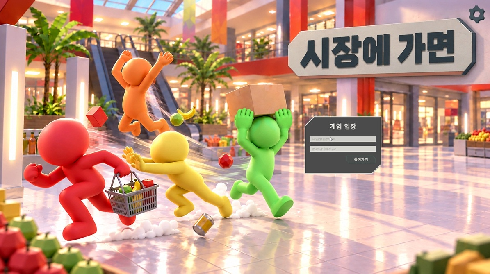
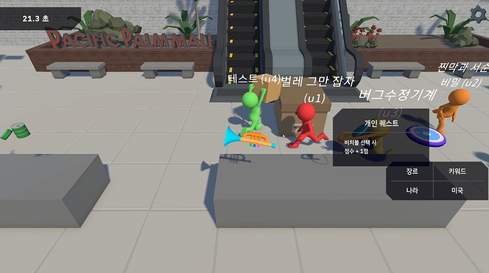
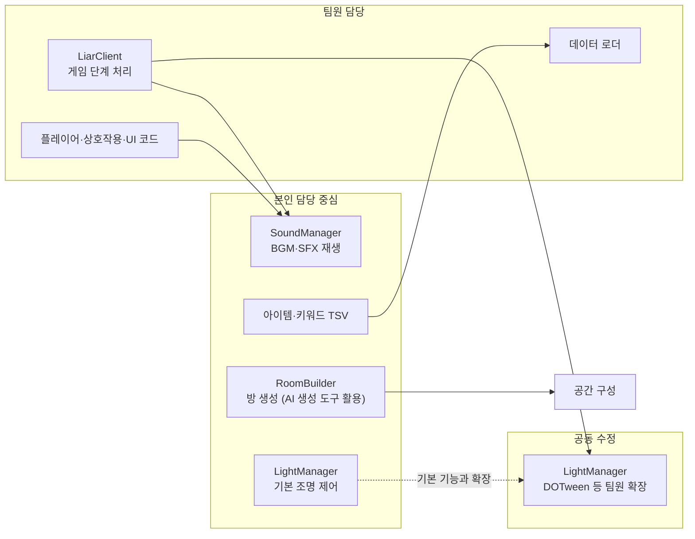
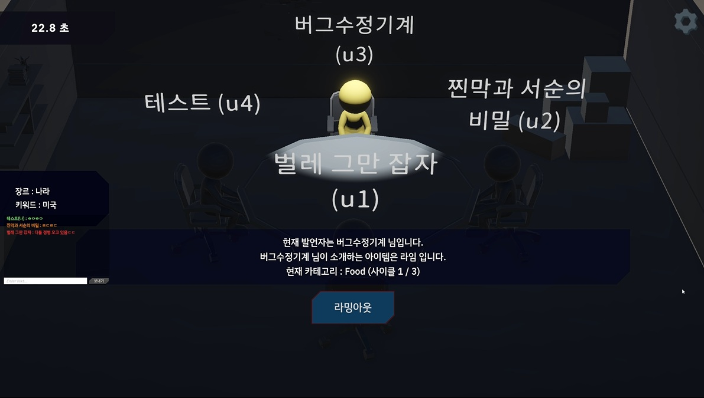
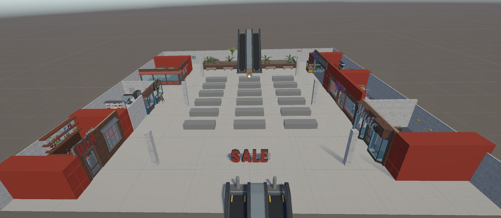
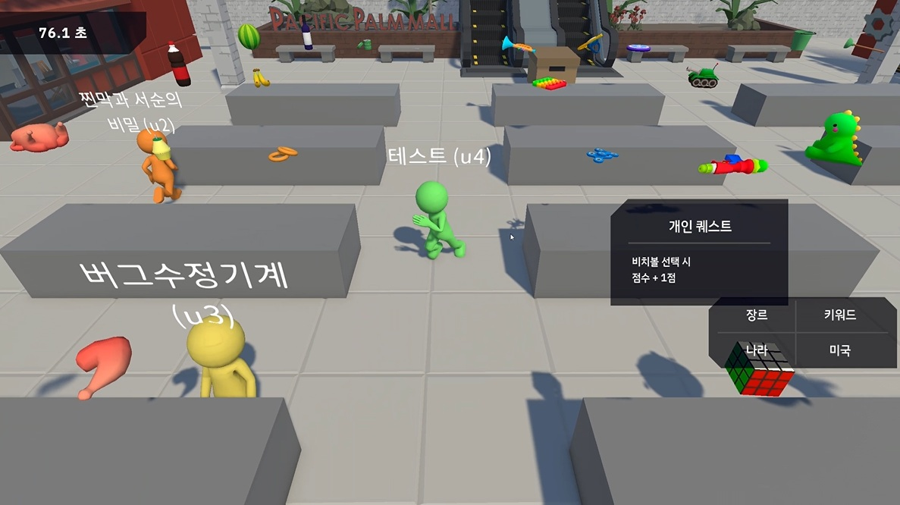
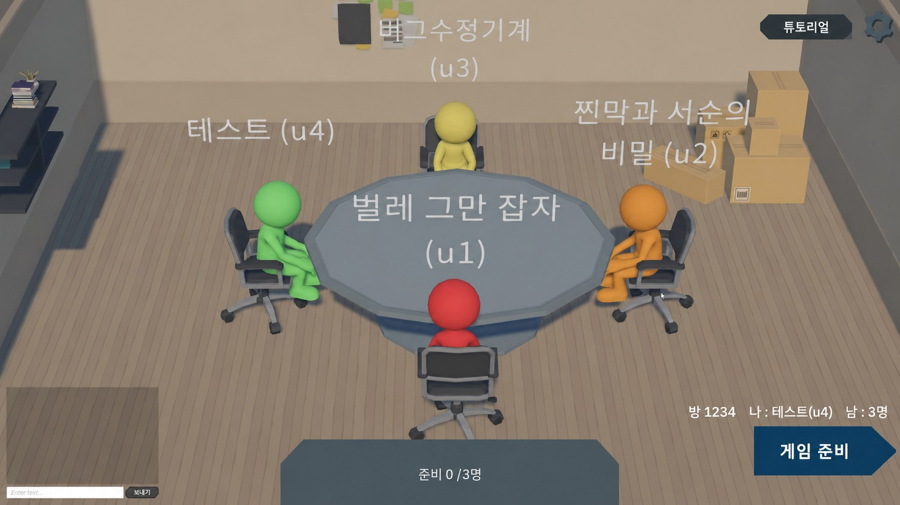

# 시장에 가면 기술 문서

> **서로 다른 키워드를 받은 사실조차 모른 채 마트에서 물건을 고르고, 고른 물건과 발언으로 라이어를 찾아내는 멀티플레이 추리 게임**

| 항목 | 내용 |
|---|---|
| 장르 | 4인 멀티플레이 추리·심리전 파티 게임 (3D 탑다운) |
| 개발 기간 | 2026.08.18 ~ 2026.09.10 |
| 개발 인원 | 4인 팀 프로젝트 (**팀장**) |
| 개발 환경 | Unity 6000.3.15f1, C# |
| 담당 작업 | 팀장(일정 조율·팀 구성) · 기본 컨셉 기획 · UI 디자인 · 맵 디자인 · 기본 조명 제어 · 사운드 재생 구조 · TSV 데이터 작성 · 아이템 크기 조정 |
| 주요 기술 | enum·Dictionary 기반 사운드 관리 · Transform 기반 조명 제어 · BoxCollider Bounds 기반 매대 위치 계산 · TSV 데이터 테이블 |
| AI 활용 | 타이틀 화면 이미지 생성 (구도는 직접 스케치) · 바닥·벽 생성 도구 `RoomBuilder` 코드 생성 (3.2 · 4.4) |
| 링크 | [GitHub](https://github.com/KooHoo-Dev/3rd-TeamProject-SH) · [시연 영상](https://youtu.be/9w9CUTdm4PU) |

> 4명이 함께 만든 게임이라, 이 문서에는 그중 직접 맡은 작업을 중심으로 적었다. 서버와 게임 진행, 데이터 로더는 팀원들이 만들었다. 조명과 사운드처럼 함께 고친 부분은 누가 어디까지 했는지 절마다 나눠 두었다.
>
> 수업에서 받은 코드(`Assets/10. Scripts/9. Utils`)와 외부 에셋은 내 작업에 포함시키지 않았다. 바닥·벽 생성 도구 `RoomBuilder`도 AI가 만든 코드를 가져다 쓴 것이다(3.2).

---

## 1. 개요

### 1.1 무엇을 만들었나

- 타이틀


**시장에 가면**은 마트에서 아이템을 선택하는 단계와 회의실에서 발언·지목·투표하는 단계가 연결되는 멀티플레이 게임이다.

한 라운드는 장르·키워드 배정 → 마트에서 물건 고르기 → 회의실로 돌아와 발언 → 의심 가는 사람 지목 → 변론 → 투표와 결과 공개 순서로 진행된다.

```text
로비
  → 게임 시작·장르 및 키워드 배정
  → 마트 진입·아이템 선택
  → 회의실 복귀·발언
  → 지목·변론·투표
  → 결과 처리
```
- 회의실

- 마트


| 구분 | 내용 |
|---|---|
| 게임 목표 | 마트에서 고른 물건과 발언을 단서로 키워드가 다른 한 명(라이어)을 찾아내기. 여러 라운드의 누적 점수로 최종 순위를 정함 |
| 플레이 인원 | 3명 이상이면 게임 시작 가능 (기획 기준 4인) |
| 일반 플레이어와 라이어의 차이 | 모두 같은 장르 안에서 키워드를 받고, 라이어 1명만 다른 키워드를 받음. 나머지 플레이어는 같은 키워드. **자신이 라이어인지 아무도 알 수 없음** |
| 승리 조건 | 라운드마다 점수를 정산하고, 모든 라운드가 끝난 뒤 누적 점수가 높은 순으로 순위 발표 (아래 점수 표) |
| 마트 규칙 | 라운드마다 서버가 정한 카테고리 3개가 마트의 세 구역에 하나씩 배정됨. 카테고리마다 물건을 1개씩 골라 맵 중앙의 상자에 넣어야 최종 선택으로 인정. 제한 시간 안에 고르지 못하면 랜덤 아이템이 주어짐. 다른 플레이어가 먼저 집은 물건은 집을 수 없음. 먼저 다 고른 플레이어는 마트를 돌아다니며 다른 플레이어를 밀쳐 방해할 수 있음 |
| 라운드 반복 규칙 | 라운드는 `회의실 → 마트 → 회의실` 순서. 회의는 카테고리 단위의 **사이클**로 반복하며, 사이클마다 `발언 → 지목 → 변론 → 투표 → 라이어 키워드 맞추기`를 진행. 기본 설정은 **3라운드 × 라운드당 3사이클** |
| 조작 방법 | WASD·방향키 이동 · F 아이템 집기/내려놓기 · Space 다른 플레이어 밀치기 · Tab(누르는 동안) 장르·키워드·발언 기록 확인 · Enter 채팅 입력 · 마우스로 UI 선택 |

**회의 사이클의 단계** (클라이언트 `Protocol.TurnMessageType` 기준)

| 단계 | 내용 |
|---|---|
| 발언 | 서버가 정한 순서대로 현재 발언자가 이번 카테고리에서 고른 물건을 보여 주며 특수 채팅으로 발언 |
| 지목 | 라이어로 의심되는 플레이어를 지목하거나 지목 스킵. 유효한 지목 결과가 없으면 다음 사이클로(마지막 사이클이면 다시 진행) |
| 변론 | 지목된 플레이어가 제한 시간 동안 일반 채팅으로 변론 |
| 투표 | 변론 대상에 대해 `라이어다`·`모르겠다`·`라이어가 아니다` 중 하나를 선택 |
| 라이어 키워드 맞추기 | 라이어가 일반 플레이어의 키워드를 추측해 입력 |
| 라밍아웃 | 발언 단계에서 버튼으로 "내가 라이어"라고 스스로 밝히는 특수 턴(`LiarSelfDisclose`). 실제 라이어면 바로 키워드 맞추기로 전환. 라이어가 아니면 **본인에게만** "라이어가 아니다"라는 문구가 뜨고, 다른 플레이어는 누른 사실을 알 수 없음 |

- 지목


- 투표


- 결과 공개


**제한 시간** (서버 기본 설정): 마트 100초 · 발언 30초 · 지목 30초 · 변론 20초 · 투표 20초 · 라이어 키워드 맞추기 20초

**점수** (서버 기본 설정)

| 상황 | 점수 |
|---|---|
| 라이어가 일반 키워드를 맞힘 | 라이어 +2 |
| 라이어가 키워드를 못 맞힘 | 일반 플레이어 +1 |
| 라이어가 투표 대상이 되지 않음 | 라이어 +1 |
| 투표 대상이 된 플레이어 | −1 |
| 투표 (대상이 실제 라이어일 때) | `라이어다` +1 · `모르겠다` 0 · `라이어가 아니다` −1 |
| 투표 (대상이 라이어가 아닐 때) | `라이어다` −1 · `모르겠다` 0 · `라이어가 아니다` +1 |
| 라밍아웃 — 실제 라이어 | 키워드를 맞히면 +2, 못 맞히면 −2 |
| 라밍아웃 — 라이어가 아닌 플레이어 | −1 |
| 마트 퀘스트 성공 | +1 |

점수는 0 아래로 내려가지 않는다. 게임 진행·점수 계산은 모두 서버(팀원 담당)에서 처리한다.


### 1.2 왜 만들었나

말 이어가기 놀이 「시장에 가면」에서 출발했다. 이 놀이는 장소 하나를 정하면 돌아가며 그 장소와 관련된 물건을 말하고, 더 떠올리지 못하거나 앞에서 나온 물건을 제대로 기억하지 못하면 진다.
여기에 라이어 게임을 결합해, **한 명에게만 다른 키워드를 주고 각자 키워드와 관련된 물건을 직접 집어 온 뒤 왜 집어 왔는지 설명 혹은 해명하게 하면** 재미있겠다는 생각으로 기획을 시작했다. 게임 이름도 이 놀이에서 따왔다.

일반적인 라이어 게임에서는 라이어가 자신이 라이어라는 사실을 안다. 이 게임은 **서로 다른 키워드를 받았다는 사실조차 모른 채** 마트에서 물건을 선택하게 하여, 라이어를 포함한 **모든 플레이어가 불확실성을 갖도록** 기획했다.

- 다른 플레이어의 선택을 해석하는 과정에서 **자신의 판단도 의심**하게 된다.
- 타 플레이어가 마트에서 어떤 물건을 골랐는지가 추리의 단서가 된다.
- 라이어 역시 자신의 정체를 확신할 수 없으므로, 스스로 마트에서 물건을 고를 때조차 신중하게 된다.

컨셉 기획 단계에서 정리한 예시는 다음과 같다.

```text
일반 키워드: 스키장 / 라이어 키워드: 수영장
고른 물건 — A: 장갑 · B: 오뎅 · C: 털모자 · D: (수영)고글
```

고글은 스키장과 수영장 어느 쪽에도 어울리므로, 물건만으로는 D가 라이어인지 단정할 수 없다. 고른 이유를 듣고 해석하는 과정이 필요하다.

또한 마트에는 키워드와 정확히 들어맞는 물건이 반드시 있는 것이 아니다. 플레이어에게는 키워드와 다소 거리가 있는 물건을 고를 수밖에 없는 상황 역시 주어지고, 발언 단계에서 그 물건을 고른 이유를 **순발력 있게 설명하고 그럴듯한 근거를 붙여야** 한다. 이 변명과 해석의 과정이 기존 라이어 게임과 구별되는 이 게임의 핵심 재미이다.

**기획 단계의 우려와 대응**

| 컨셉 기획 때의 우려 | 대응 | 결과 |
|---|---|---|
| 반복해서 플레이하려면 아이템 구성이 다양해야 함 | 장르 12개·키워드 240개, 6개 카테고리의 아이템 176개를 TSV로 작성 (→ 3.5) | 가짓수를 충분히 확보하지 못함 (→ 5.4) |
| 진행이 채팅과 투표에 크게 의존해 플레이가 단조로울 수 있음 | 마트에 **밀치기**와 **개인 퀘스트**를 넣어 소소한 변수를 둠 | 함께 수강한 동료들의 플레이 테스트 피드백에서 밀치기가 특히 좋은 평가를 받았고, 실제 플레이에서도 서로 열심히 밀치며 방해를 즐기는 모습을 확인. 개인 퀘스트 때문에 생뚱맞은 물건을 고른 플레이어가 해명하는 장면이 웃음을 만드는 것도 확인 |

- **밀치기:** 직접 멀티플레이 게임을 하면서, 오버워치처럼 같은 팀임에도 일부러 다른 플레이어의 길을 막거나 가만히 있는 플레이어를 슬쩍 밀어 떨어뜨리는 식의 가벼운 방해를 즐기는 사람이 많다는 것을 체감했다. 이 장난스러운 방해를 마트에 넣은 목적은 두 가지다.
  - 마트에서 생길 수밖에 없는 빈 시간을 지루하지 않게 보내게 한다.
  - 밀치기를 물건 고르기보다 더 즐기는 주객전도를 노렸다. 시간 안에 물건을 고르지 못하면 랜덤 아이템을 들고 가게 되고, 회의실에서 그 물건을 해명하느라 진땀을 빼는 상황이 생긴다.
- **개인 퀘스트:** 수행하면 점수를 얻지만, 키워드와 관련 없는 물건을 골라야 하는 상황이 생긴다. 그 물건 때문에 라이어로 의심받으면 스스로 해명해야 한다. 점수와 의심이라는 장단점을 함께 주는 선택이다.

**레퍼런스: [Liar Game (Steam)](https://store.steampowered.com/app/3555700/Liar_Game/?l=koreana)**

한 명씩 차례로 발언하고, 지목·변론·투표로 라이어를 가려내는 진행 방식은 이 게임을 참고했다. 여기에 다음 세 가지 요소를 추가했다.

| 레퍼런스와 다른 점 | 내용 |
|---|---|
| 모두가 자신의 역할을 모름 | 라이어도 자신이 라이어인지 알 수 없음 |
| 마트에서 물건 고르기 | 말뿐 아니라 마트에서 고른 물건이 추리의 단서가 됨 |
| 순발력 있는 변명 | 키워드와 딱 맞는 물건이 없어도, 고른 물건에 그럴듯한 이유를 붙여 설명해야 함 |

처음 기획에서 실제 구현까지 바뀐 규칙은 4.5에 정리했다.

### 1.3 담당 범위

| 구분 | 담당 내용 | 팀원 작업과의 경계 |
|---|---|---|
| 팀장 | 일정 조율, 팀원 선발, 빌드 테스트(총 7회) 후 버그 목록 정리·분배 | 각 버그의 수정은 담당 팀원이 진행 |
| 기본 컨셉 | 게임의 기본 컨셉 기획 (모두가 자신의 역할을 모르는 라이어 게임 + 마트 물건 선택) | 턴·투표 세부 루프와 서버 메시지 설계는 팀원 담당 |
| UI | 로비·회의실·투표·튜토리얼 등의 화면 디자인 작업 | 서버 상태에 따른 UI 갱신 로직과 구분 |
| 맵 | 로비·회의실·마트 공간 디자인과 배치 작업 | 게임 진행·아이템 배정 로직과 구분 |
| 사운드 | BGM·SFX 분리, enum과 클립 매핑, 재생 메서드 | 볼륨 조절과 `PauseBGM()`은 팀원 수정 영역 |
| 조명 | 초기 조명 설정, 발언자 위치에 따른 기본 스포트라이트 제어 | DOTween 밝기 연출·라이어·승자 조명은 팀원 확장 |
| 데이터 | 아이템·장르·키워드 TSV 작성 및 수정 | TSV 파싱과 게임 데이터 로딩은 팀원 담당 |
| 아이템 | 카테고리별 아이템 크기 조정 | 외부 모델 자체 제작과 구분 |

이 문서는 **공용 사운드 재생 구조**, **공간 배치**, **기본 조명 제어**, **UI·데이터 작업의 협업 연결**을 중심으로 기술한다.

---

## 2. 시스템 구조

### 2.1 담당 기능과 팀 시스템의 연결



팀원 코드는 "지금 어떤 소리가 필요한지"만 전달하며, 해당 클립을 조회하여 재생하는 처리는 `SoundManager`가 담당한다.

조명은 본인이 만든 기본 제어 위에 팀원이 연출을 더한 공동 수정 파일이다(범위 → 3.4).

### 2.2 핵심 클래스 역할 분담

| 클래스 | 역할 | 구현 범위 |
|---|---|---|
| `SoundManager` | BGM·SFX 식별자와 클립 매핑, 공통 재생 창구 | 본인 구현 중심, 볼륨 등 일부 공동 수정 |
| `LightManager` | 조명 초기화, 발언자 위치로 스포트라이트 이동 | 기본 제어 본인, DOTween 및 결과 연출 팀원 |
| `RoomBuilder` | 바닥·벽 프리팹으로 방 생성 및 정리 | AI로 생성한 에디터 도구 — 본인은 활용만 함 (3.2) |
| `CategoryAreaManager` | 구역 크기를 기준으로 매대 위치 계산 | 본인 담당 (최종 게임 적용 범위는 3.3 참고) |
| `ChairManager` | 좌석 위치 조회와 캐릭터 배치 | 본인 구현 중심, 캐릭터 상태 적용은 팀원 코드와 연결 |
| `FollowingPlayer` | 초기 위치를 오프셋으로 사용하는 카메라 추적 | 공동 수정 |
| `AreaData` | 구역별 매대와 아이템 목록 보관 | 공동 수정, `AddItems()`는 팀원 담당 |

**역할을 나눈 이유**

사운드·조명·공간 배치는 서로 완전히 다른 역할을 하기 때문에 클래스를 분리했다. 팀원이 필요한 매니저 하나만 알면 호출할 수 있도록, 호출 규칙을 단순하게 정하여 공유했다.

| 매니저 | 팀원에게 공유한 호출 규칙 |
|---|---|
| `SoundManager` | 상황에 맞는 **enum 이름만 넘기면** 재생된다 (`PlaySfx(GameSfx.ItemPickUp)`) |
| `LightManager` | 발언 차례가 돌아올 때 **해당 플레이어의 Transform만 넘기면** 그 위치에 스포트라이트가 켜진다 |

---

## 3. 핵심 기능

### 3.1 enum 기반 공용 사운드 관리

#### enum 값만 넘겨 재생하기

호출하는 쪽은 오디오 클립을 직접 참조하지 않고, 상황에 맞는 enum 값만 전달하면 된다.

```csharp
// 호출 예시 — 팀원 코드에서 사용하는 형태
SoundManager.Instance.PlayBGM(SoundManager.GameBGM.Mart);
SoundManager.Instance.PlaySfx(SoundManager.GameSfx.ItemPickUp);
```

| 메서드 | 동작 |
|---|---|
| `PlayBGM(GameBGM bgm)` | 대응하는 BGM을 반복 재생 |
| `PlaySfx(GameSfx sfx)` | 대응하는 효과음을 `PlayOneShot()`으로 재생 |
| `StopBGM()` | 현재 BGM 정지 |

실제 게임에서는 마트 진입·회의실 복귀·투표와 같은 단계마다 BGM이, 아이템 줍기·내려놓기·플레이어 밀치기·팝업 열기와 같은 동작마다 효과음이 지정되어 있다.

#### 식별자와 클립 매핑

`InitDictionaries()`는 Inspector에 등록한 배열을 enum 키의 Dictionary로 변환한다.

```csharp
private void InitDictionaries()
{
    bgmDict = new Dictionary<GameBGM, AudioClip>();
    for (int i = 0; i < bgmClips.Length; i++)
    {
        bgmDict[(GameBGM)i] = bgmClips[i];
    }

    sfxDict = new Dictionary<GameSfx, AudioClip>();
    for (int i = 0; i < sfxClips.Length; i++)
    {
        sfxDict[(GameSfx)i] = sfxClips[i];
    }
}
```

재생 요청 시에는 `TryGetValue()`로 클립을 조회한다.

```csharp
public void PlaySfx(GameSfx sfx)
{
    if (sfxDict.TryGetValue(sfx, out var clip))
    {
        sfxAudioSource.PlayOneShot(clip);
    }
    else
    {
        Debug.LogWarning("SFX not found");
    }
}
```

따라서 호출하는 코드에는 `ItemPickUp`, `VoteButtonClick`과 같이 상황 이름만 남으며, 어떤 클립을 연결할지는 사운드 매니저 한 곳에서만 변경하면 된다.

다만 enum 순서와 Inspector 배열 순서가 일치해야 한다는 약점이 있다. 순서가 하나라도 어긋나면 의도하지 않은 클립이 재생된다.

**목표한 경험과의 연결:** 마트는 물건을 고르고 다른 플레이어를 밀치는 가벼운 구간이라 발랄한 BGM을, 회의실은 스스로 의심받지 않으면서 다른 플레이어를 의심해야 하는 구간이라 긴장감 있는 BGM을 두었다.

#### BGM과 SFX 분리

BGM과 SFX는 서로 다른 `AudioSource`를 사용한다.

- BGM: 클립을 지정하고 `loop = true`로 반복 재생
- SFX: `PlayOneShot()`으로 단발 효과음 재생

AudioSource는 먼저 BGM용과 SFX용으로 나누었고(커밋 `1c8a9e85`), 이후 각각을 자식 오브젝트로 분리했다(커밋 `773525a3`).

**분리하게 된 계기:** 처음에는 AudioSource 하나로 BGM과 SFX를 함께 재생했으나, 이 방식으로는 BGM과 효과음의 음량을 **따로 조절할 수 없었다.** 따라서 두 소리를 서로 다른 AudioSource로 분리하는 것이 적절하다고 판단했다.

**공동 작업 범위:** 볼륨 조절 메서드와 관련 UI 연결, `PauseBGM()`은 팀원 작업으로 구분한다.

### 3.2 바닥·벽 생성 도구 활용 (AI 생성 코드)

회의실과 마트의 바닥·벽은 `RoomBuilder`라는 에디터 도구로 제작했다. 이 도구는 **AI로 생성한 코드**이며, 본인은 이를 공간 제작에 **활용**했다.

| 항목 | 내용 |
|---|---|
| 사용법 | 바닥·벽 프리팹과 가로·세로 개수를 Inspector에 넣고, 컴포넌트 메뉴의 `Generate Room`으로 사각형 방을 생성 |
| 사용 범위 | 회의실과 마트의 바닥·벽. 로비는 회의실과 같은 공간을 사용 |
| 직접 한 작업 | 생성된 방 위에 매대·소품을 눈으로 확인하며 직접 배치 (→ 4.2) |

바닥·벽과 같은 단순 반복 작업은 도구에 맡기고, 공간 구성과 동선처럼 판단이 필요한 배치에 시간을 할애하기 위해 이 방식을 택했다(생성 결과를 확인한 과정 → 4.4).

### 3.3 구역 크기에 따른 매대 배치 계산

`CategoryAreaManager`에는 BoxCollider의 Z축 길이를 3등분하여 각 구간의 중앙에 매대를 배치하도록 구현했다.

```csharp
private void GetDisplayStandPosition()
{
    BoxCollider boxCollider = GetComponent<BoxCollider>();
    areaLength = boxCollider.bounds.size.z;
    float startPoint = boxCollider.bounds.min.z;
    float dividedLength = areaLength / DisplayStandMaxCount;

    for (int i = 0; i < DisplayStandMaxCount; i++)
    {
        float z = startPoint
            + dividedLength * i
            + dividedLength * 0.5f;

        Vector3 position =
            new Vector3(boxCollider.bounds.center.x, 0f, z);

        displayStandPositions.Add(position);
    }
}
```

생성된 매대에는 `SetAreaNum(areaNum)`으로 구역 번호를 전달하고, 생성 개수는 최대 3개로 제한한다.

**설계 의도:** 구역마다 매대를 세 줄로 두는 배치(→ 3.6 맵 디자인)를 코드로 옮긴 것이다. 매대 하나에 아이템을 **세 개씩** 올리자는 아이디어 또한 본인이 제안했으며, 이 코드는 그 방향으로 처음 작성한 것이다.

**실제 적용 과정**

| 시점 | 내용 |
|---|---|
| 초기 (커밋 `de0c8f36`, 08-28) | 구역마다 `CategoryAreaManager`를 두고, 테스트 키(Q)로 매대 3개를 자동 생성 |
| 최종 (커밋 `fff1c3d6`, 09-03) | 마트 맵을 업데이트하면서 매대를 씬에 **직접 배치**하고, 자동 생성 테스트 호출은 주석 처리 |

따라서 최종 마트 씬의 매대는 이 코드로 생성된 것이 아니다. 여기서는 초기에 구역 크기로 매대 위치를 계산하던 방식을 소개한다.

이 계산은 월드 좌표 Bounds를 사용하고 Y를 0으로 고정했기 때문에, 구역이 회전되어 있거나 높이가 다르면 정확한 위치를 산출하지 못한다.

### 3.4 발언자 위치에 따른 기본 조명 제어

발언자의 Transform을 받으면 주변 조명을 어둡게 하고, 해당 플레이어 위로 스포트라이트를 이동시킨다.

**목표한 경험과의 연결:** 지금 누가 발언하고 있는지를 텍스트뿐 아니라 시각적·공간적으로도 알 수 있게 하려 했다.

```csharp
public void TurnOnSpotLight(Transform currentSpeaker)
{
    directionalLight.intensity = zeroIntensity;
    RenderSettings.ambientIntensity = zeroIntensity;

    spotLight.transform.position =
        new Vector3(
            currentSpeaker.position.x,
            10f,
            currentSpeaker.position.z
        );

    spotLight.enabled = true;
}
```

| 메서드 | 기본 동작 |
|---|---|
| `InitLights()` | Directional Light와 환경광 값을 복구하고 스포트라이트 비활성화 |
| `TurnOnSpotLight(Transform)` | 대상의 X·Z 위치로 스포트라이트 이동 후 활성화 |
| `TurnOffSpotLight()` | 초기 조명 상태 복구 |

누가 발언자인지는 조명 매니저가 결정하지 않는다. 발언 순서는 게임 진행 코드가 결정하며, 조명은 전달받은 Transform의 위치를 비추는 역할만 수행한다.

**본인 담당:** 초기 조명 설정과 기본 스포트라이트 제어.

**팀원 확장:** DOTween 밝기 변화, 테이블 포커스, 라이어 색상 연출, 복수 승자 조명.

최종 게임의 발언자 연출에는 팀원이 확장한 `TurnOnDotween()`을 사용한다.

- 발언 단계


### 3.5 TSV 데이터 작성과 아이템 연결

아이템과 키워드 정보는 `Assets/StreamingAssets/Table` 아래 TSV 파일로 관리한다.

| 파일 | 주요 열 |
|---|---|
| `category_items.tsv` | `ItemId`, `CategoryType`, `CategoryName`, `ItemName`, `PrefabKey` |
| `genre_keywords.tsv` | `KeywordId`, `GenreType`, `GenreName`, `KeywordName` |

`category_items.tsv`에는 아이템 식별자·카테고리·표시 이름과 프리팹 경로가 함께 기록된다.

```text
본인: TSV 데이터 작성·수정
  → 팀원: TSVReader와 테이블 로더로 읽기
  → 팀원: PrefabKey로 프리팹 로드
  → 팀원: 아이템 정의와 게임 시스템에 연결
```

팀원의 `ItemTable.Load()`가 `PrefabKey`를 그대로 `Resources.Load<MartItem>()`에 전달하기 때문에, 표에 기록한 경로가 Resources 내부의 실제 프리팹 경로와 일치해야 한다.

카테고리 로더는 직전 행과 카테고리가 달라지는 지점에서 항목을 구분하여 읽는다. 따라서 같은 카테고리의 행은 반드시 연속으로 기록해야 했다.

**데이터 구성**

| 표 | 구성 |
|---|---|
| `genre_keywords.tsv` | 12개 장르 × 장르당 20개 키워드 = 240개 (동물·색깔·나라·게임·명절·기념일·직업·영화·장소·스포츠·과목·교통수단·별자리) |
| `category_items.tsv` | 6개 카테고리, 176개 아이템 — 식품 37 · 주방용품 27 · 생활용품 21 · 문구 18 · 공구 21 · 완구/레저 52 |

- 장르·키워드 표


- 카테고리·아이템 표


표 작성 시 같은 카테고리의 아이템을 모두 연속된 행에 기록하여 로더 규칙에 맞췄다.

**데이터 작성 기준**

| 표 | 기준 |
|---|---|
| 장르 | 키워드를 들었을 때 **마트 물건이 연상되기 좋은** 장르 |
| 카테고리 | 실제 마트에 있을 법한 물건으로 구성 |

**담당 범위:** TSV 데이터 작성과 수정이며, 파서·Resources 로더 구현은 팀원 담당이다.

### 3.6 UI·맵 디자인과 아이템 크기 조정

로비·회의실·투표·튜토리얼 UI와 마트 공간을 작업했으며, 카테고리별 아이템의 크기를 조정했다.

| 작업 | 구체적인 내용 |
|---|---|
| UI 디자인 | 가독성과 **보기 편한지**를 가장 중요하게 보고, UX 중심으로 배치·수정 |
| 맵 디자인 | 매대를 동선의 **중앙**에 두고, 카테고리 구역마다 매대를 **세 줄**로 배치해 같은 카테고리의 아이템이 한 공간에 모이게 함 |
| 아이템 크기 조정 | **캐릭터 크기를 기준**으로, 실제로 이 정도 크기여야 설득력 있다고 느껴지도록 카테고리별(식품·가정용품·주방용품·문구용품 등) 스케일 조정 |
| 팀원 기능 연결 | 팀원이 기능 개발 중 필요한 UI를 디자인·배치 없이 동작만 하게 먼저 만들면, 본인이 UX를 고려해 다듬는 방식. 일부는 본인이 UI를 만들고 팀원이 호출할 수 있게 연결 |

- 마트 전경


- 매대와 아이템


- 로비


- 설정·튜토리얼


---

## 4. 고민과 선택

### 4.1 사운드 호출 방식

현재는 각 기능이 `GameBGM`·`GameSfx` enum을 전달하면 사운드 매니저가 해당 클립을 조회하는 구조이다(→ 3.1).

| 방법 | 장점 | 단점 |
|---|---|---|
| **A. enum으로 호출 (선택)** | IDE 자동 완성(Tab)으로 바로 고를 수 있고, 없는 이름은 컴파일 단계에서 걸러짐 | enum과 Inspector 클립 배열의 순서를 맞춰야 하고, 틀려도 Dictionary 생성 시점에 검출하지 않음 (→ 3.1) |
| B. 문자열 이름으로 호출 | 클립 이름을 그대로 쓰면 되어 따로 enum을 만들 필요가 없음 | 오타가 실행 중에야 드러나고, 어떤 이름이 있는지 호출하는 쪽에서 알기 어려움 |

→ 문자열로 호출하는 방법도 검토했으나, 사운드를 호출하는 쪽이 대부분 팀원 코드였기 때문에 **Tab 자동 완성으로 쉽게 고를 수 있는 enum이 모두에게 편하다**고 판단했다. 팀원에게는 "상황에 맞는 enum 이름만 넘기면 된다"고 설명했다.

### 4.2 반복 배치를 코드로 처리하는 범위

바닥·벽처럼 규칙적으로 반복되는 배치는 AI로 생성한 도구(`RoomBuilder`)에 맡겼다. `CategoryAreaManager`에는 구역 길이에 따른 매대 위치 계산을 구현했다.

다만 이 방식은 규칙적으로 반복되는 배치에만 적용할 수 있으며, 동선이나 보기 좋은 구성, 장식 배치는 자동으로 결정하지 못한다.

| 대상 | 방법 | 이유 |
|---|---|---|
| 바닥·벽 | AI로 생성한 `RoomBuilder`로 생성 | 사각형 방을 만드는 단순 반복 작업이라 도구 하나로 처리하는 편이 빠름 |
| 매대·소품 | 씬에서 직접 배치 | 동선과 보기 좋은 구성을 **눈으로 확인하며** 옮겨야 했음 |

매대 역시 처음에는 `CategoryAreaManager`로 자동 배치했으나(3.3), 최종 마트 맵에서는 직접 배치하는 방식으로 변경했다.

### 4.3 공동 수정 코드의 역할 분담

조명(3.4)·사운드(3.1)·데이터(3.5)는 본인이 기본 기능이나 내용을 만들고 팀원이 기능을 추가하거나 연결한 부분이다. 파일마다 나눈 범위는 각 절에 적었다.

본인은 **기본 기능**까지만 구현하고, 서버와 주고받는 처리나 초기화 로직이 필요한 부분은 해당 파트를 맡은 팀원이 판단하여 보완하는 방식으로 역할을 나누었다. 볼륨 조절이나 조명 DOTween 연출처럼 UX·연출 측면에서 필요한 기능도 팀원이 자율적으로 추가하도록 했다.

### 4.4 AI 결과물을 확인하고 고친 과정

AI는 타이틀 이미지와 바닥·벽 생성 도구(`RoomBuilder`) 두 곳에 사용했다. 두 경우 모두 결과를 직접 확인하고, 의도와 다른 부분은 다시 요청하거나 직접 고쳤다.

| 대상 | 요청 방식 | 확인 방법 | 의도와 달랐던 점 | 대응 |
|---|---|---|---|---|
| 타이틀 이미지 (ChatGPT) | 처음에는 구도와 동작을 글로만 설명 | 생성된 이미지를 직접 보고 판단 | 손이 여러 차례 어색하게 생성됨 | 구도와 동작을 직접 스케치해 무엇이 문제이고 어떤 결과를 원하는지 보여 주자, 그제서야 의도대로 나옴 |
| `RoomBuilder` | 프리팹을 컴포넌트에 넣고 가로·세로 개수를 정하면 바닥·벽이 깔리도록 요청 | 먼저 실행해 의도대로 생성되는지 확인 | 벽과 바닥 사이에 틈이 생김 | 만들 방이 회의실과 마트 두 개뿐이라, 도구를 고치기보다 씬에서 직접 보며 수정 |

- 타이틀 구도 스케치


이미지는 글로 설명을 반복하는 것보다, 직접 그린 스케치로 원하는 결과를 보여 주는 편이 효과적이었다.

### 4.5 처음 기획과 달라진 규칙

| 항목 | 처음 기획 | 실제 구현 | 바꾼 이유 |
|---|---|---|---|
| 회의 진행 | 물건 공개 → 토론 → 원할 때 조기 투표 | 사이클마다 발언 → 지목 → 변론 → 투표 → 키워드 맞추기를 고정 순서로 진행 | 레퍼런스로 삼은 라이어 게임의 진행 방식을 따름. 한 명씩 **공평하게 발언권**을 주는 것이 타당하다고 판단 |
| 투표 | 라이어 지목 투표 → 변론 → 확정 재투표 | 지목(또는 지목 스킵) → 변론 → `라이어다`·`모르겠다`·`라이어가 아니다` 투표 | 레퍼런스 라이어 게임의 투표 방식을 따름. `모르겠다`를 두어 확신 없는 플레이어가 **무작정 찍지 않도록** 함 |
| 자진 라이어 선언 | 회의 중 언제든 버튼으로 선언 | 발언 단계에서만 라밍아웃 버튼 활성화 | 아무 때나 누를 수 있으면 **게임 흐름을 계속 끊을** 수 있어 시점을 제한 |
| 점수 | 이른 사이클에 라이어를 맞힐수록 높은 점수 | 사이클과 관계없이 정해진 점수, 투표 선택별 점수 (1.1 점수 표) | 개발 기간 안에 완성하기 위해 타협 |
| 카테고리 잠금 | 마트 진입 시 카테고리 구역 1개를 잠가 선택 불가 | 넣지 않음 | 구현할 것이 많은 상황에서 꼭 필요한 기능이 아니라고 회의에서 결정 |
| 선택을 마친 뒤 | 먼저 고른 플레이어가 다른 플레이어를 관전하는 기능 검토 | 마트를 돌아다니며 다른 플레이어를 밀쳐 방해 | 기다리는 동안에도 직접 참여할 여지를 두기 위함 (1.2 우려와 대응) |

---

## 5. 결과 및 배운 점

### 5.1 구현 결과

본인이 구현한 기능은 실제 게임에서 다음과 같이 사용되었다.

- 게임 진행·플레이어·UI 코드에서 공통 사운드 API 호출
- 발언자 Transform을 이용한 기본 조명 제어
- TSV에 작성한 아이템 정보를 팀원 데이터 로더와 연결

**검증:** 빌드 테스트를 **총 7회** 진행했다. 매 회차 한 라운드 전체를 플레이하며 발생한 버그를 모두 기록·정리하고, 담당자가 이를 가져가 수정·커밋하는 방식으로 운영했다.

**기획 목표 달성 여부:** 모두가 자신이 라이어인지 모르는 데서 오는 불확실성과 긴장감을 실제 플레이에서 확인했다. 핵심 재미로 삼은 변명과 해석도 함께 수강한 동료들의 플레이 장면에서 확인했다. 키워드와 거리가 있는 물건을 고른 플레이어가 그 이유를 해명하고, 다른 플레이어들이 그 설명을 듣고 의심하며 해석하는 모습이 실제로 나타났다. 다만 아이템 가짓수가 부족하다는 피드백도 있었다(→ 5.4).

### 5.2 트러블슈팅: Enter 입력으로 설정창이 열리는 문제

Enter 키를 누르면 의도하지 않게 설정창이 열리는 버그를, 버튼의 Navigation 설정을 비활성화하여 해결했다(커밋 `3b830a02`).

| 구분 | 내용 |
|---|---|
| **문제** | 채팅을 입력하고 Enter를 누르면, 채팅이 전송되는 대신 **설정창이 열림** |
| **원인** | 설정 버튼(`SettingsButton`)의 Navigation이 `Automatic`으로 되어 있어, 키보드 입력으로 선택이 설정 버튼으로 옮겨진 상태에서 Enter(Submit)가 버튼 클릭으로 처리됨 |
| **해결** | 공통 UI 프리팹(`CommonUI`)에서 `SettingsButton`의 Navigation을 `None`으로 변경 (커밋 `3b830a02`). 다음 날 같은 문제가 생길 수 있는 다른 버튼들의 Navigation도 함께 끔 (커밋 `0ad205fc`, CommonUI·LobbyUI·MeetingRoomUI) |
| **결과** | Enter 키가 채팅 입력에만 쓰이게 됨 |

마우스로 조작하는 UI 버튼에는 키보드 Navigation이 필요하지 않으나, 기본값(`Automatic`)이 활성화되어 있으면 키 입력이 의도하지 않은 버튼으로 전달될 수 있음을 알게 되었다.

### 5.3 협업에서 드러난 내 작업의 문제: 아이템 스케일

| 구분 | 내용                                                                                                                                    |
|---|---------------------------------------------------------------------------------------------------------------------------------------|
| **문제** | 아이템을 회전시키거나 다른 동작을 적용할 때 의도와 다르게 움직여, 해당 기능을 맡은 팀원이 이를 처리하느라 고생함                                                                      |
| **원인** | 본인이 아이템 크기를 맞추면서 프리팹의 Transform 스케일을 `(1, 1, 1)`이 아닌 값으로 직접 바꿨음. 스케일은 가급적 `(1, 1, 1)`로 두어야 한다는 것을 그때는 몰랐음 (3D를 제대로 공부하고 시작하지 않았음)     |
| **해결** | 담당 팀원이 해당 기능 쪽에서 수정                                                                                                                   |
| **결과·배운 점** | 보기 좋은 크기만 맞추면 될 줄 알았지만, 스케일 값이 다른 사람의 코드(회전·배치)에 영향을 준다는 것을 알게 됨. 다음에는 모델 자체 크기나 자식 오브젝트로 크기를 맞추고 루트 스케일은 `(1, 1, 1)`로 유지해야겠다는 생각을 했음 |

이와 유사하게, 매대에 아이템 세 개를 올리는 기능은 본인이 처음 방향을 정했으나, 서버와 데이터를 주고받는 과정에서 세 명의 코드가 혼재하게 되어 이를 정리하는 데 팀원이 많은 수고를 들였다.

### 5.4 아쉬운 점과 개선 방향

개발 완료 후 코드를 다시 검토하고 플레이 피드백을 돌아보며 확인한 한계와 개선 방향은 다음과 같다.

| 구분 | 현재 한계 | 개선 후보 |
|---|---|---|
| 사운드 데이터 | enum과 배열 순서에 의존 (→ 4.1) | 식별자·클립을 함께 등록하고 누락·중복 검사 |
| BGM 재생 | 같은 BGM 요청도 다시 재생 | 현재 클립과 재생 상태 확인 후 처리 |
| 매대 위치 계산 | 반복 계산 시 위치 리스트에 값이 누적됨 | 재계산 전에 목록 초기화 |
| 아이템 가짓수 | 아이템 모델 에셋을 구하기 어려워 가짓수가 부족했고, 플레이 피드백에서도 지적됨. 당시에는 AI로 모델을 생성하는 방법을 떠올리지 못함 | AI로 아이템 모델을 생성해 가짓수를 크게 늘리기 |
| 아이템 스케일 | 프리팹 루트 스케일을 직접 바꿔 회전·배치 코드에 영향 | 루트 스케일 `(1, 1, 1)` 유지, 크기는 모델·자식 오브젝트에서 조정 |

팀 구조의 한계와 개선 방향은 5.5의 4번에 적었다.

### 5.5 배운 점

1. **공용 기능을 팀원 코드에 연결한 경험**  
   기능을 구현하여 전달하는 것만으로는 충분하지 않으며, 서버와 데이터를 주고받는 상황에서의 **초기화 로직**도 충분히 고려했어야 했음을 배웠다.

2. **데이터와 실제 에셋의 일치가 필요한 이유**  
   `PrefabKey`로 프리팹을 찾기 때문에, 파일 이름을 언제든 쉽게 찾을 수 있도록 하나하나 정리했다. 카테고리를 잘못 분류하여 아이템이 다른 구역에 스폰되는 경우도 있었으며, 표의 값 하나가 게임 화면에 그대로 반영된다는 것을 알게 되었다.

3. **UI·맵 제작과 코드 구현의 연결**  
   처음에는 외형만 보기 좋게 만들면 된다고 생각했으나, 스케일 문제(5.3)를 겪으며 **디자인 작업도 다른 사람의 코드에 영향을 준다**는 것을 알게 되었다.

4. **팀장으로서 다음 프로젝트에서 바꿀 점**  
   팀장으로서 일정을 조율하고 팀을 구성했으나, 초기 구조 확립이 미흡하여 구조가 자주 바뀌었고 그때마다 소통과 수정이 필요했다. 다음 프로젝트에서는 개발 초기에 공통 구조와 담당 경계를 먼저 정할 것이다.