# 토끼와 거북이 기술 문서

> **압도적으로 느린 거북이가 함정과 수류탄으로 토끼를 방해하며 승리를 노리는 3D 싱글플레이 경주 게임**

| 항목 | 내용 |
|---|---|
| 장르 | 3D 싱글플레이 경주 · 슬랩스틱 코미디 |
| 개발 기간 | 2026.10.21 ~ 2026.11.04 |
| 개발 인원 | 1인 |
| 개발 환경 | Unity 6000.3.15f1 · C# · Cinemachine · UniTask · NavMesh |
| AI 활용 | 코딩 AI(ChatGPT)를 활용한 구현·오류 분석·수정, 아스트라를 활용한 원형 코스 맵 제작, 바르코 AI를 활용한 BGM·의인화 캐릭터 모델 제작, 디자인 전반은 AI에 맡겨 제작 |
| 담당 역할 | 게임 규칙 및 연출 기획, AI 작업 범위 지정, Unity 내 적용·조정, 플레이 검증 |
| 링크 | [GitHub](https://github.com/KooHoo-Dev/3rd_3D_1-3D-Project-BaekShyoun) · [시연 영상](https://youtu.be/9TG4n2-oFPk) · [숏폼](https://youtube.com/shorts/oyh4-LH40bI) |

> 게임 코드는 AI가 구현을 보조하고 적용 및 수정은 직접 하는 방식으로 진행했습니다. 이 문서는 기획을 AI에게 맡길 수 있는 작업 단위로 분할하고, 산출된 결과를 의도에 맞게 수정·검증한 과정을 기술합니다.

---

## 1. 개요

### 1.1 무엇을 만들었나

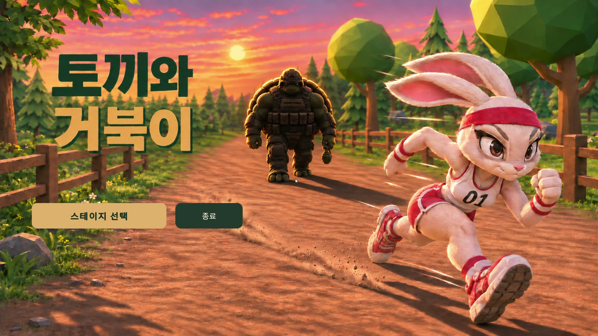

동화 「토끼와 거북이」에서 영감을 얻은 경주 게임입니다. 달리기만으로는 토끼를 결코 이길 수 없는 거북이가 각종 방해 수단을 활용하여 토끼를 방해하여 승리를 쟁취합니다.

경주 전에는 지뢰를 설치하고, 경주 중에는 수류탄을 투척합니다. 그렇게 폭발에 우스꽝스럽게 날아간 토끼가 정신을 차리고 코스로 복귀하는 동안 거북이가 토끼를 역전하여 승리하는 것이 핵심입니다.

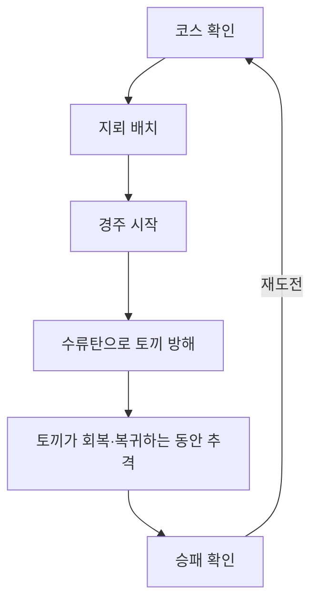

| 구분 | 내용                                 |
|---|------------------------------------|
| 플레이어 목표 | 방해공작으로 토끼를 방해하고 토끼보다 먼저 결승선에 도착하기  |
| 준비 단계 | 토끼의 이동 경로를 고려해 지뢰 배치               |
| 경주 단계 | 거북이를 직접 조작하며 수류탄 사용                |
| 핵심 피드백 | 폭발에 따른 토끼의 물리 반응과 코스 복귀            |
| 구성 | 튜토리얼 A·B·C, 원형 코스의 본 경주, 스토리 및 타이틀 |

| 조작 | 입력 |
|---|---|
| 이동 | WASD · 방향키 |
| 카메라 회전 | 마우스 우클릭을 누른 채 이동 |
| 수류탄 꺼내기 / 넣기 | 우클릭을 누른 채 F |
| 수류탄 투척 | 우클릭으로 조준 중 좌클릭 |
| 지뢰 설치 (준비 단계) | 좌클릭 · 마우스 휠로 화면 확대·축소 |
| 대사 넘기기 | Enter |

### 1.2 왜 만들었나

**동화 「토끼와 거북이」를 모티브로, 압도적으로 느린 거북이가 속도 대신 황당한 방해공작으로 토끼를 이기는 게임**을 만들고자 했습니다. 동화 속 거북이가 수류탄과 지뢰를 쓰는 엉뚱함과, 토끼가 우스꽝스럽게 날아가는 모습으로 웃음을 주는 것이 목표였습니다.

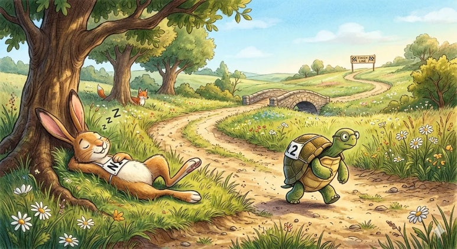

방해공작으로는 단순히 토끼가 앞으로 나아갈 수 없게끔 시간을 벌 뿐입니다. 따라서 사용 시점과 위치가 중요하며, 토끼가 날아갔다가 코스로 복귀하는 데 걸리는 시간도 승패에 영향을 주도록 설계했습니다.

---

## 2. 기획을 플레이 규칙으로 구체화하기

### 2.1 네 가지 경주로 보여주는 규칙의 변화

튜토리얼은 조작법을 안내하는 동시에, 거북이가 방해공작을 사용하게 되기까지의 스토리를 보여 주도록 구성했습니다.

| 구간 | 경주 규칙 | 전달하려는 경험                  |
|---|---|---------------------------|
| Tutorial A | 토끼가 잠들지 않으며 공격·함정 사용 불가 | 정상적인 달리기로는 극복하기 어려운 속도 차이 |
| Tutorial B | 토끼가 잠들며 공격·함정 사용 불가 | 동화 `토끼와 거북이`를 직접 체험       |
| Tutorial C | 토끼가 잠들지 않으며 공격·함정 사용 가능 | 직접 상대를 방해해 승리할 기회를 만드는 경험 |
| Stage 1 | 원형 코스에서 공격·함정 사용 | 배운 규칙을 활용해 경주하기           |

Tutorial A는 거북이, 즉 플레이어가 토끼의 속도를 실감할 수 있게 하는 스테이지로, **져도 이야기가 이어져야** 합니다. 다른 경주처럼 패배 시 재도전만 허용하면 의도한 도입부로 진행할 수 없습니다.

따라서 `RaceManager`에서 Tutorial A에 한해 토끼가 승리해도 튜토리얼을 완료한 것으로 처리하고 다음 이야기로 진행하도록 했습니다.

### 2.2 준비와 실행을 나눈 방해공작

방해공작은 사용 시점에 따라 두 가지로 구분했습니다.

| 도구 | 사용 시점 | 플레이어의 판단 |
|---|---|---|
| 지뢰 | 경주 시작 전 | 토끼가 지나갈 위치를 예상하고 배치 |
| 수류탄 | 경주 도중 | 현재 거리와 토끼의 위치를 보고 조준·투척 |

지뢰는 경주 전에 미리 수립하는 작전이고, 수류탄은 경주 중에 실시간으로 상황을 판단해 사용하는 수단입니다. 두 도구 모두 폭발로 토끼를 지연시킨다는 점은 같으나, 판단이 필요한 시점이 다릅니다.

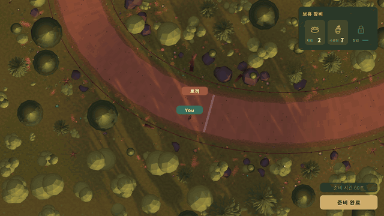

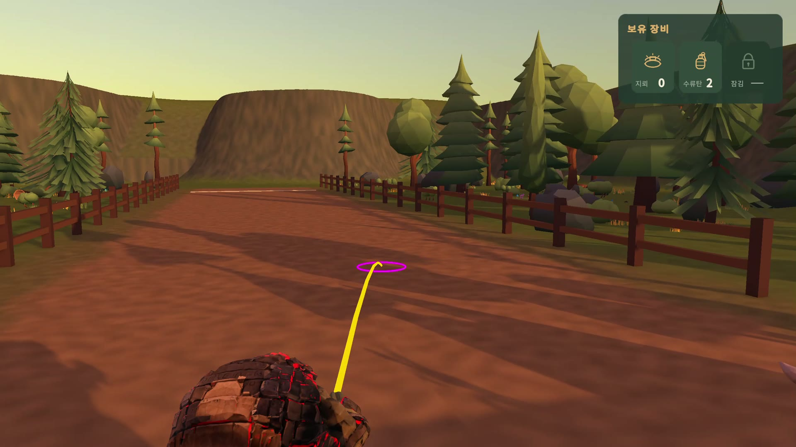

### 2.3 흑화 — 반전 연출

거북이의 변화를 대사로만 전달하지 않고, 스토리 진행에 따라 외형과 타이틀 화면도 실제로 변경되도록 했습니다.

흑화 여부는 저장되므로 게임을 다시 실행해도 바뀐 타이틀이 유지됩니다(담당 클래스와 저장 방식 → 3.2).

- 흑화 전 타이틀 : 평범한 동화를 기반으로 한 경주 게임으로 보이게끔 착각시킵니다.
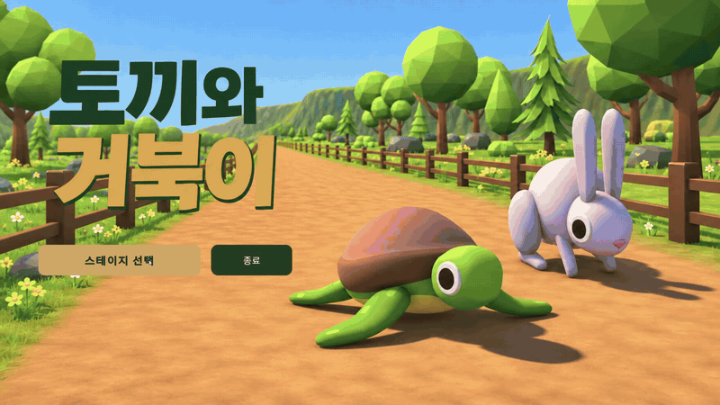

- 스토리 진행 중 갑작스레 변화한 거북이와 토끼의 외형 : 평범한 동화속 이야기인줄 알았던 세계에서,
무섭게 변화한 거북이의 외형으로 괴리감과 웃음을 주게끔 유도하였습니다.
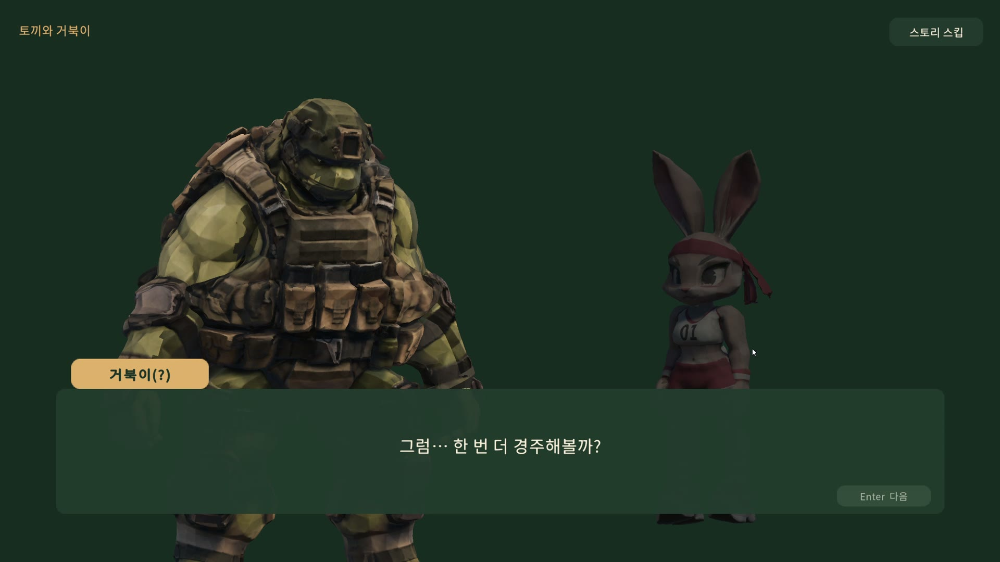

**화면·캐릭터·소리를 함께 바꾸기**

흑화는 이 게임의 반전 요소입니다. 거북이와 토끼는 더 이상 귀여운 동화 속 캐릭터가 아니므로, 흑화 후에는 동화 대신 **전장**의 느낌을 주고자 했습니다. 이 반전을 그림뿐 아니라 소리로도 느껴지게 하려고, 장면마다 흑화 전과 흑화 후의 분위기를 따로 정하고 그에 맞는 소리를 넣었습니다.

| 요소 | 흑화 전 | 흑화 후 | 바뀌는 기준 |
|---|---|---|---|
| 타이틀 화면 | 평범한 동화 경주 게임처럼 보이는 타이틀 | 의인화된 거북이와 토끼 (1.1) | 저장된 흑화 여부 |
| 캐릭터 외형 | 동물 | 의인화 캐릭터 | 스토리 진행 |
| 타이틀 BGM | 동화적인 분위기 | 전장을 연상시키는 웅장함 | 저장된 흑화 여부 |
| 경주 BGM | 밝고 발랄한 경주 | 웅장함과 경주에 필요한 추진력 | 공격이 가능한 경주(Tutorial C · Stage 1)인지 |
| 발소리 | 동물의 발소리(토끼는 깡충 뛰는 소리) | 사람의 발소리 | 〃 |

외형이 바뀌는 순간에는 화면을 0.5초 동안 어둡게 했다가 다시 밝히는 사이에 동물을 의인화 캐릭터로 바꿨습니다. 이 순간에 따로 소리 연출은 넣지 않았으며, 바뀐 BGM은 흑화 스토리가 끝난 뒤의 타이틀과 경주부터 들립니다.

플레이 테스트에서는 거북이의 반전된 외형을 보고 웃는 반응도 있었습니다. 동화 같던 분위기가 갑자기 뒤집히는 괴리감이 의도대로 전달되었습니다.

효과음은 무료 음원 사이트(Pixabay)에서 골라 적용했습니다.

**BGM을 만든 과정**

AI로 장면별 BGM 생성 프롬프트를 구체화하고, 바르코 AI로 BGM을 제작해 게임에 적용했습니다.
처음 생성된 흑화 후 BGM은 우스꽝스럽게 들려 반전의 무게감이 없었습니다. 그래서 전장과 같은 웅장함이 필요하다고 다시 요청했고, 경주 BGM은 그 분위기를 유지하면서 질주감이 나도록 요청했습니다. 한 번 고쳐 요청한 뒤 바로 의도에 맞는 결과를 얻었습니다.

음악은 AI가 생성했으나, 장면별로 요구되는 분위기를 정하고 결과물의 적합성을 판단해 선택하는 작업은 본인이 수행했습니다. 장면과 흑화 여부에 따른 재생은 `SoundManager`가 담당합니다.

---

## 3. 시스템 구조

### 3.1 전체 흐름

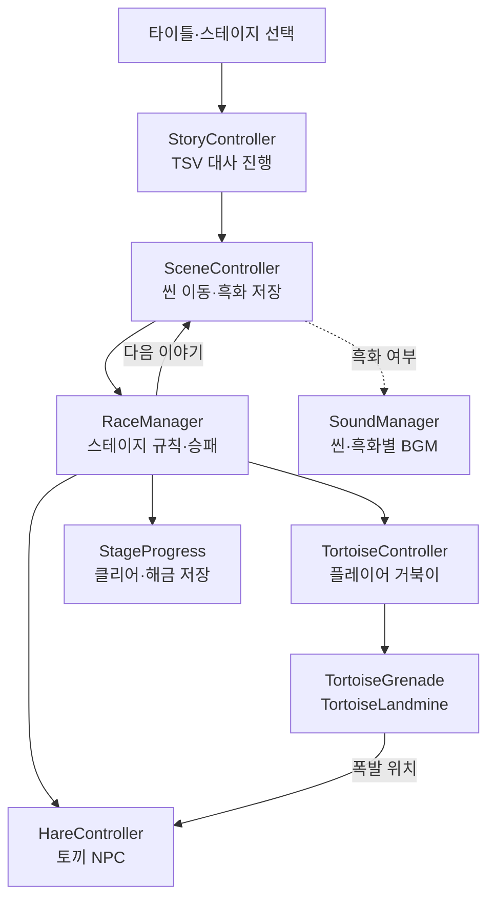

튜토리얼 전체가 스토리와 경주가 번갈아 이어지는 구조입니다.
스토리가 끝나면 `SceneController`가 다음 경주 씬으로 전환하고, 
경주가 끝나면 `RaceManager`가 다음 스토리로 연결합니다. 
폭발은 수류탄·지뢰가 자신의 위치를 토끼에게 전달하는 방식으로 처리합니다.

### 3.2 핵심 클래스 역할 분담

| 클래스 | 역할                                                                                                |
|---|---------------------------------------------------------------------------------------------------|
| `RaceManager` | 스테이지 유형(`StageType`)에 따라 수면·공격·준비 단계 사용 여부 결정, 준비 시간과 카운트다운, 수류탄·지뢰 남은 개수, 결승 판정과 결과 처리, 다음 스토리 연결 |
| `HareController` | 토끼 NPC. 결승점·경유점 이동, 수면, 폭발 넉백과 래그돌, 착지 후 기상과 코스 복귀 (`HareState`: 이동·수면을 위한 이동·수면·피격·기상·복귀)        |
| `TortoiseController` | 플레이어 거북이. 이동과 카메라, 수류탄 조준(포물선·착지 지점 표시)과 투척                                                       |
| `TortoiseGrenade` · `TortoiseLandmine` | 폭발 이펙트·사운드를 재생하고, 폭발 위치를 토끼에게 전달                                                                  |
| `StoryController` | TSV 대사를 한 줄씩 진행, 화자 표시, 동물 → 의인화 캐릭터 전환 연출                                                        |
| `SceneController` | 스토리 재생 요청과 스토리 종료 후 이동할 씬 결정, 흑화 여부 저장                                                            |
| `StageProgress` | 스테이지 클리어 기록과 해금 규칙(앞 스테이지를 깨야 다음이 열림)                                                             |
| `SoundManager` | 씬과 흑화 여부에 따른 BGM, 효과음 재생                                                                          |

진행 상태(흑화 여부, 스테이지 클리어)는 `PlayerPrefs`에 저장합니다(플레이어에게 보이는 변화 → 2.3).

**역할을 나눈 이유:** 클래스 구성은 AI가 아닌 본인이 직접 결정했습니다. 경주 규칙, 토끼, 거북이, 폭발, 스토리, 씬 이동, 진행 저장, 사운드와 같이 **역할마다 클래스를 나누는 것**을 기준으로 삼았습니다.

다만 더 세분화가 필요한 부분도 있었습니다. 분리할 경계가 모호해 한 클래스에 남겨 둔 결과, `HareController`(520줄)와 같이 전체적으로 길어진 클래스가 생겼습니다. 이는 이후 리팩터링에서 개선할 부분입니다(→ 6.3).

### 3.3 폭발 위치에서 토끼를 날리는 방향

수류탄과 지뢰는 자신의 폭발 위치를 `ApplyKnockback()`에 전달하고, 토끼는 폭발 중심에서 바깥쪽으로 날아갑니다.

```csharp
Vector3 direction = transform.position - explosionPosition;
direction.y = 0f;
if (direction.sqrMagnitude < 0.0001f)
{
    direction = -transform.forward;
    direction.y = 0f;
}
direction.Normalize();

Vector3 impulse = direction * horizontalImpulse + Vector3.up * upwardImpulse;
```

폭발 중심과 토끼의 수평 위치가 거의 겹치면 방향을 결정할 수 없으므로, 토끼의 뒤쪽을 보조 방향으로 사용합니다.
래그돌이 있는 토끼는 이 속도를 모든 뼈에 적용하고, 골반을 중심으로 한 회전 속도를 더해 사지가 각각 휘날리며 회전하면서 날아가도록 했습니다.

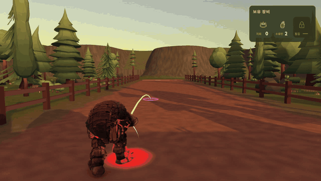

---

## 4. AI와의 작업 방식

### 4.1 직접 결정한 부분과 AI에 맡긴 부분

| 구분 | 직접 담당                                                                       | AI 활용                                         |
|---|-----------------------------------------------------------------------------|-----------------------------------------------|
| 게임 기획 | 승리 방식, 튜토리얼별 규칙, 캐릭터 변화와 연출 방향 결정                                           | 구현 방법과 필요한 작업 검토                              |
| 기능 구현 | 기본적인 게임 루프 구현, 요구사항과 수정 범위 지정, Unity 설정 및 적용, 결과 확인                         | 코드 제안·작성·수정, 오류 원인 분석                         |
| 플레이 검증 | 실제 동작과 기획 의도 비교, 재현 상황 전달                                                   | 관련 코드와 설정을 조사하고 수정안 제시                        |
| BGM 제작 | 장면별 분위기 지정, 생성 결과 판단 및 적용. 효과음(SFX)은 Pixabay에서 직접 골라 적용                                  | 프롬프트 구체화 후 바르코 AI로 BGM 생성                     |
| 맵 제작 | 직선 코스(튜토리얼)와 원형 코스(본 경주) 구성 결정, 경유점 배치                                      | 원형 코스 맵을 아스트라로 제작                             |
| 디자인 | 생성 결과 판단 및 적용                                                               | 디자인은 전적으로 AI에 맡겨 제작                           |
| 캐릭터 모델링 | 바르코 AI로 의인화 토끼·거북이 모델을 직접 생성, 어색한 부분을 판단해 수정 방향을 요청하고 Blender에서 스크립트를 실행·확인 | 바르코 AI로 의인화 모델 생성, 코딩 AI로 Blender 수정용 Python 스크립트 작성 |

코드에서도 같은 기준으로 분담했습니다. **클래스 구성과 전체 구조는 본인이 직접 설계**하고, 래그돌·넉백 등의 **물리 구현**과 `SoundManager`처럼 정해진 구조 안에서 반복되는 **단순 작업**은 AI에게 맡겼습니다.

AI가 설명한 코드를 직접 적용하고 확인한 후 다음 단계로 진행한 방식과, 씬 전환이나 UI처럼 범위를 지정하고 AI가 직접 수정하게 하는 방식을 활용하였습니다.

### 4.2 큰 요청을 확인 가능한 작업으로 나누기

기능은 과제 번호를 붙여 분할하고, 각 과제의 완료 여부를 확인한 후 다음 과제로 진행했습니다.

| 작업 묶음 | 주요 내용 |
|---|---|
| 경주의 핵심 동작 | 폭발, 피격, 래그돌 |
| 경주 규칙 | 튜토리얼별 기능 제한, 승패 판정, 원형 코스 진행 |
| 게임의 흐름 | 스토리, 씬 전환, 타이틀과 스테이지 선택 |
| 표현과 마무리 | UI, 사운드, 빌드 후 플레이 확인 |

문제가 생겼을 때 어느 지점에서 오류가 발생했는지 추적하고 되돌리기 용이하게 하고자 AI에게 수정 내용을 작은 단위로 나누어 제시하도록 요청하였습니다.
UI, 사운드, 씬 전환과 같은 목적이 분명한 로직의 경우, 다른 게임 로직은 수정하지 않도록 범위를 지정했고, 완료 여부는 사전에 전달한 과제 목록을 기준으로 확인했습니다.

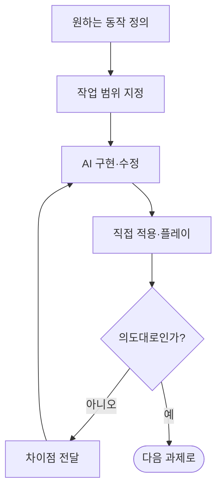

### 4.3 AI가 Unity 에디터를 직접 다룬 첫 프로젝트

이 프로젝트에서 처음으로 **AI가 Unity 작업 자체를 직접 수행**하도록 했습니다.

| 방식 | AI가 한 일 | 맡긴 작업 예 |
|---|---|---|
| 에디터 화면 직접 조작 (Computer Use) | Unity 에디터 창을 보고 클릭·입력 | 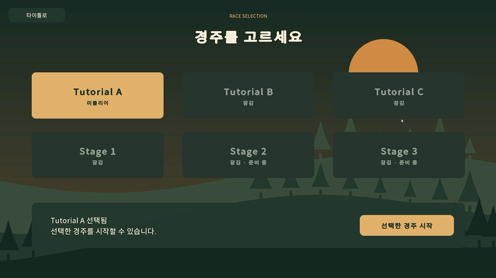<br>스토리 씬 구성, 튜토리얼 맵 꾸미기, 스테이지 선택 UI 배치 |
| 씬·프리팹 파일 직접 수정 | 터미널에서 `.unity`·`.prefab` 파일을 읽고 고침 | 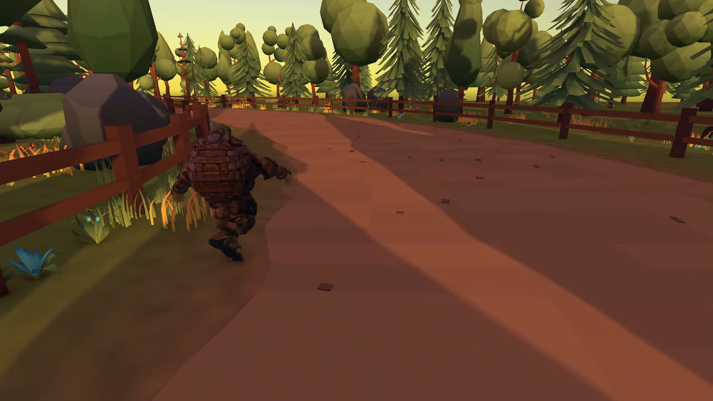<br>코스를 따라 울타리 배치, Tutorial C에서 맞춘 값을 Stage 1에 그대로 옮기기 |

---

## 5. 고민과 선택

### 5.1 순간이동으로 복구되는 토끼를 걸어서 복귀하도록 수정

**문제**

원형 코스에서 폭발에 맞은 토끼가 피격 전 위치로 순간이동했습니다. 경주는 계속 진행할 수 있었으나, 의도한 동작은 착지한 위치에서 일어난 뒤 걸어서 복귀하는 것이었습니다.

**판단**

토끼가 복귀하는 과정도 경주의 일부이며, 원래 위치로 순간이동하면 그 시간이 모두 사라지므로 필수적으로 고쳐야 할 요소였습니다.

**수정 과정**

직접 플레이하며 순간이동을 확인한 후, 확인 결과 순간이동의 원인은 **AI가 앞서 원형 코스에서 피격 전 위치로 바로 재배치하도록 안내한 코드**였습니다.

이후 복구 위치의 기준을 피격 전 위치에서 착지한 래그돌의 골반 위치로 변경하고, 원형 코스에서는 피격 전 위치 주변을 다시 탐색하지 않도록 수정했습니다.

```csharp
Vector3 recoveryPosition = ragdollHips.position;
bool foundPosition
    = NavMesh.SamplePosition(recoveryPosition, out NavMeshHit hit, 3f, agent.areaMask);

if (foundPosition == false && RaceManager.Instance.IsStage1 == false)
{
    foundPosition = NavMesh.SamplePosition(prevPos, out hit, 3f, agent.areaMask);
}
```

토끼는 착지 지점 근처에서 일어난 뒤, 기존 복귀 상태(`SetReturnStat()`)로 피격 전 위치까지 걸어갑니다.

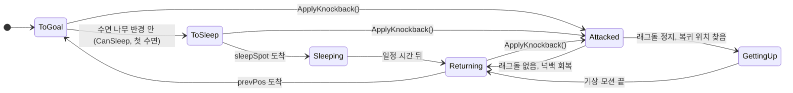

토끼 NPC(`HareController`)의 행동 상태 전입니다. 피격(`Attacked`)된 토끼는 순간이동하지 않고 기상(`GettingUp`)과 복귀(`Returning`)를 거쳐 다시 경주(`ToGoal`)로 돌아갑니다.

경주의 정상 진행 여부와 함께 **토끼가 돌아오는 모습까지 의도대로인지** 직접 플레이로 확인했습니다.

### 5.2 튜토리얼 규칙을 스테이지 유형으로 관리

**문제**

튜토리얼별로 수면과 공격 가능 여부를 나누는 과정에서, AI는 개별 기능을 켜고 끄는 설정을 제안했습니다. 그러나 각 튜토리얼은 사용할 규칙의 조합이 이미 정해져 있었습니다.

**판단과 선택**

현재 `RaceManager`는 스테이지 유형에 따라 수면·공격·준비 단계의 사용 여부를 결정합니다(스테이지별 규칙 → 2.1).

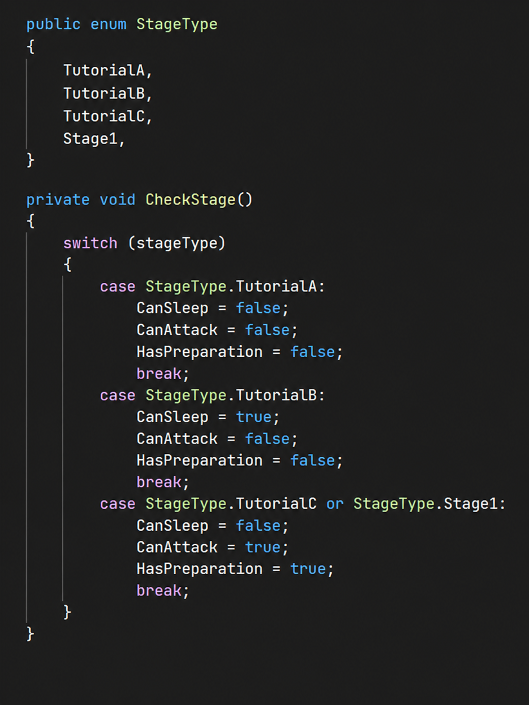

| 방법 | 씬에서 하는 일 | 좋은 점 | 아쉬운 점 |
|---|---|---|---|
| A. 기능마다 스위치를 따로 두기 (AI의 처음 제안, `canSleep` 등) | "잠: 켬 / 공격: 끔 / 준비: 끔"처럼 스위치 세 개를 씬마다 하나씩 맞춤 | 기능 하나만 따로 켜고 끄기 쉬움 | 튜토리얼마다 조합이 이미 정해져 있는데, 매번 손으로 맞추다 하나만 틀려도 규칙이 어긋남 |
| **B. "이 씬은 튜토리얼 B"처럼 종류 하나만 고르기 (선택, `StageType`)** | 스테이지 종류 하나만 고름 | 종류에 맞는 스위치 세 개가 `CheckStage()` 한 곳에서 한꺼번에 정해져 조합이 틀릴 일이 없음. 스테이지가 늘어날 것을 대비해 enum 끝에 쉼표를 남김 | 결과 문구·다음 이야기처럼 스테이지마다 달라지는 다른 처리는 여전히 다른 메서드에서 따로 나뉨 (→ 6.3) |

B를 선택했습니다. 처음 AI가 기능별 스위치를 제안했을 때 switch문을 이용하여 enum으로 씬 종류를 나누는 것이 더 낫다고 판단하였습니다.

그 결과 각 구간에서 사용 가능한 기능을 `CheckStage()` 한 곳에서 확인할 수 있게 되었습니다.

### 5.3 출발 위치와 실제 이동 경로를 구분

**문제**

원형 코스에서 토끼는 안쪽, 거북이는 바깥쪽에서 출발하도록 하였습니다.
그런데 출발 위치만 지정하면, 경유점이 코스 가운데에 있을 때 토끼는 출발 직후 코스 가운데로 이동하게 됩니다. 이 문제는 작업을 시작하기 전에 미리 예상했습니다.

**판단과 선택**

경주 게임이라는 컨셉에 맞게 인코스와 아웃코스의 분류가 필수적이었다고 판단하였습니다.
따라서 출발 위치와 별도로 실제 이동 경로도 지정해야 한다는 결론에 이르러, 코스를 만들 때부터 안쪽(Inline)·바깥쪽(Outline) 경유점을 각각 만들었습니다. 바깥쪽 경유점은 토끼를 바깥쪽으로 달리게 할 경우에도 쓸 수 있도록 마련해 둔 것이었습니다.

- 원형 코스의 두 경로
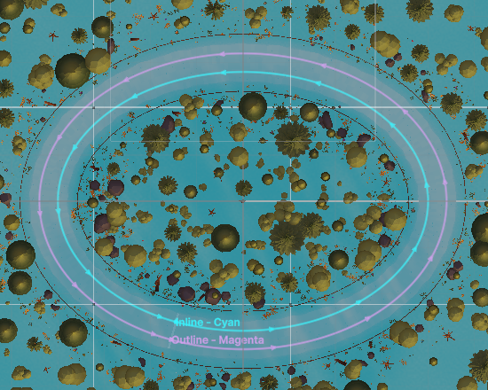

그러나 플레이 테스트를 하면서 거북이(플레이어)가 역주행으로 골인을 시도하는 전략도 시도될 수 있다는 것을 판단한 이후에는, 바깥쪽 경유점을 기준으로 코스 전체를 덮는 범위의 원을 잡아 모든 경유점을 지나야만 골인할 수 있게끔 하는 데에도 활용하였습니다.

경주처럼 공간을 다루는 기능은 **출발 위치, 실제 이동 경로, 완주 판정**을 처음부터 따로 나눠 정해야 한다는 점을 깨달았습니다.

---

## 6. 결과 및 배운 점

### 6.1 구현 및 플레이 확인

튜토리얼로 규칙을 익히고 본 경주로 넘어가는 흐름까지 완성했습니다.

최종 빌드로 아래 순서를 처음부터 끝까지 직접 플레이했습니다.

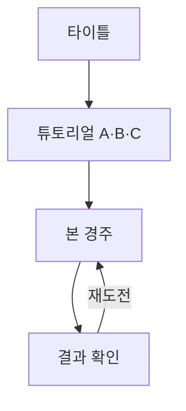

개별 기능의 동작과 함께, 씬 전환과 경주 진행 전체가 중단 없이 이어지는지 확인했습니다.

### 6.2 AI 협업에서 배운 점

**요청 시에는 동작과 완료 기준까지 명시해야 했습니다.**

"토끼를 복귀시켜 줘"라고만 요청하면 AI는 순간이동인지 걸어서 복귀하는 것인지 판단할 수 없었습니다. 시작 지점과 종료 지점, 그 사이에 보여야 할 모습까지 명시해야 의도한 결과가 나왔습니다.

**코드가 실행되는 것과 의도대로 동작하는 것은 별개였습니다.**

오류 없이 실행되더라도 토끼가 코스 가운데로 이동하거나 원래 위치로 순간이동하면 의도한 경주가 아니었습니다. 그때마다 직접 플레이하여 차이점을 설명한 후 수정 방향을 결정했습니다.

**작업을 분할하여 수정 대상을 명확히 유지할 수 있었습니다.**

작업 묶음별로 하나씩 완료했기 때문에(→ 4.2), AI에게 맡기는 범위가 넓어져도 현재 수정 중인 대상을 혼동하지 않았습니다.

### 6.3 다음에 고치고 싶은 점

AI와 빠르게 개발한 결과, 현재는 동작하지만 수정하거나 확장하기 어려운 부분, 혹은 UX를 위해 수정을 희망하는 부분이 남아 있는 상태입니다. 다음 리팩터링에서는 코드를 수정하기 쉽도록 역할을 재분배하는 것을 우선 과제로 합니다.

| 지금의 문제 | 이렇게 고치고 싶음 |
|---|---|
| **토끼 코드가 한 곳에 몰려 있음** — `HareController` 한 클래스(520줄)가 이동·수면·피격·래그돌·복귀를 모두 맡음 | 역할별로 나누기. 우선은 `partial`로 파일만이라도 나누고, 더 나아가 래그돌·복귀처럼 독립적인 부분은 별도 컴포넌트로 분리 |
| **아이템이 두 가지뿐이고, 공통 부분이 중복됨** — 수류탄과 지뢰가 폭발 이펙트·사운드·화면 흔들림 코드를 각자 똑같이 가지고 있음 | 아이템 가짓수를 늘리기 전에 공통 부분을 정리하기. 폭발하지 않는 아이템도 추가할 예정이라, 모든 아이템의 공통 약속은 **인터페이스**로 두고, 수류탄·지뢰처럼 폭발 처리를 함께 쓰는 아이템은 그 아래 **추상 클래스**로 묶을 예정 |
| **토끼가 피격 전 위치로만 돌아감** — 착지한 뒤 꼭 `prevPos`까지 걸어가야 함 | 코스 전체에 보이지 않는 복귀 지점을 깔아 두고, 착지한 곳에서 **가장 가까운 코스 지점**으로 돌아가게 하기 (원형 코스의 경유점과 같은 방식) |
| **스테이지마다 달라지는 처리가 흩어짐** — 규칙 조합은 `CheckStage()`에 모았지만, 결과 문구·다음 이야기 연결은 다른 메서드에서 따로 `StageType`을 비교함 (5.2) | 스테이지별 규칙·결과 문구·다음 씬을 한 묶음의 데이터로 모아, 스테이지를 추가할 때 데이터만 늘리기 |
| **씬·스토리 이름을 글자로 직접 씀** — `"00. Tutorial A"`, `"BeforeTutorialA"` | 이름을 한 곳에 모아 두어, 오타가 나면 실행 전에 알 수 있게 하기 |

### 6.4 회고

함께 수강한 동료들의 플레이 테스트 피드백을 바탕으로 1.2에서 목표한 두 가지 경험을 돌아보았습니다.

- **폭발에 과장되게 날아가는 토끼의 웃음**: 의도한 대로 전달되었습니다.
- **방해 도구의 사용 시점과 위치를 고르는 판단**: 판단 자체는 의도했던 대로 이루어졌으나, Stage 1(원형 코스)이 어렵다는 의견이 많았고, 수류탄·지뢰의 사용 가능 개수와 아이템 종류가 모두 부족하다는 의견도 있었습니다. 난이도 조절에는 실패한 것으로 보이며 추후 수정해야 할 부분입니다.

특히 아이템 종류가 부족했던 점은 스스로도 가장 아쉬웠던 부분입니다. 처음 컨셉 기획서에서 설계해둔 다양한 아이템을 적용하지 못해
다양한 종류의 경험을 제공하지 못했습니다. 추후 리팩터링 과정에서 이 부분을 꼭 보완하고 싶습니다.